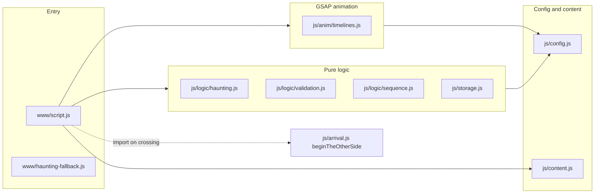
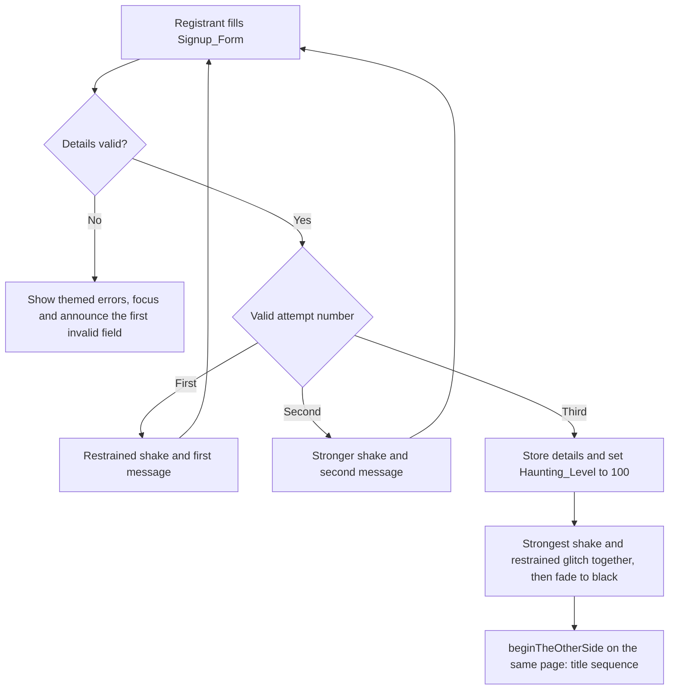

# Design Document

## Overview

Haunted_Page is the Nocturne Night invitation: a single scrolling Halloween event page in `www/index.html`. A visitor descends from a calm, eerie Hero_Section to a Signup_Form at the bottom. The interface grows more haunted as the visitor scrolls and completes the form, and that haunting doubles as feedback: candles light for valid fields, themed errors sit beside their fields, and the nightometer shows overall progress.

The first two valid submissions trigger escalating shakes and distinct messages. The third stores the details, plays the strongest shake together with a restrained glitch, fades to black, and hands off on the same page to the other side (the canvas title sequence and the Underside, specified in `.kiro/specs/upside-down-escape/`).

### Key Design Decisions

- **Small static stack with a native wrapper.** The web app is static files and ES modules with no web UI framework, CSS utility library, or bundler. The invitation uses GSAP 3.15 (local `www/gsap.min.js`) and Lenis 1.3.27 smooth scrolling (pinned unpkg URL). The editable app lives in `www/`; Capacitor 8 syncs that folder into the Android and iOS projects, and GitHub Pages deploys the same folder.
- **Pure logic is separated from the DOM.** Haunting_Level, validation, the sequence reducer, and storage are plain functions in `www/js/logic/` and `www/js/storage.js`, so they can run in Node without a browser.
- **GSAP owns the motion.** Every invitation animation comes from `createTimelines()` in `www/js/anim/timelines.js`; durations come from `TIMING` in `www/js/config.js`.
- **One explicit state machine drives the signup flow.** `ready -> shaking -> ready -> shaking -> ready -> crossing -> done`. Only valid submissions count, and each animation temporarily locks the form.
- **Visuals are CSS, inline SVG, and a few local images.** Fog, the moon scene, candles, scanlines, and the vignette are HTML elements styled by CSS custom properties. The drifting spirits are copies of `www/images/ghost.png`.
- **Reduced motion and flash safety are first-class.** `script.js` reads the preference once and passes it to every timeline factory.
- **The handoff stays on the page.** The third submission calls `beginTheOtherSide()` from `www/js/arrival.js` (loaded with `import()`), so the session, music, and page state carry straight into the other side.
- **The scroll meter reaches its base cap before the footer.** Progress is normalized to the point where the footer enters the viewport; mobile signup spacing provides a short, comfortable scroll runway.

## Architecture

### Layers



### Signup Flow



### Project Layout

```
www/                  single editable web source, Capacitor webDir, and GitHub Pages root
  index.html          the invitation, the title sequence, and the Underside
  escape.html         standalone title video; continues to ./index.html?descend
  style.css           invitation and title-sequence styles
  underside.css       Underside styles
  gsap.min.js         GSAP 3.15
  haunting-fallback.js  keeps the invitation working if the modules fail to load
  script.js           invitation entry: signup, nightometer, navigation, secret note
  images/ audio/ videos/ assets/ vendor/three/
  js/
    config.js         constants (storage key, attempts, ambient limits, timings, title and Underside settings)
    content.js        themed copy
    storage.js        sessionStorage read and write for Signup_Details
    arrival.js        the other side: title sequence, music, Go deeper
    title-sequence.js canvas title sequence
    logic/            haunting, validation, sequence, title-sequence, and underside rules
    anim/timelines.js shared GSAP timeline factories
    underside/        the Underside
tests/                Node test runner suites
scripts/serve.mjs     local HTTP server rooted at www/
android/ ios/         Capacitor native projects; synced web copies are generated here
.github/workflows/deploy.yml  GitHub Pages deployment of www/
.kiro/
  steering/           product, tech-stack, code-conventions, design-language, underside
  hooks/              review-crossing-flow.json
```

## Components and Interfaces

### `js/config.js`

```js
export const SIGNUP_STORAGE_KEY = 'nocturne-night:signup';
export const MAX_ATTEMPTS = 3;
export const MAX_AMBIENT_EFFECTS = 8;
export const MOBILE_AMBIENT_EFFECTS = 4;
export const TIMING = Object.freeze({
  shakeFirst: 520,
  shakeSecond: 700,
  shakeThird: 900,
  glitch: 1500,
  handoff: 700,
  reduced: 250
});
```

### `js/logic/haunting.js`

```js
computeHauntingLevel(scrollProgress, validFieldCount, totalFields = 2) // -> integer 0..100
isIntense(level)                // -> level > 75
ambientCount(level, isMobile)   // -> integer 1..max (max is 8, or 4 on mobile)
ambientSpeed(level)             // -> loop duration in seconds, 8 at level 0 down to 3 at level 100
```

- `scrollProgress` is clamped to 0..1 and the valid ratio to 0..1.
- Level = `min(100, round(60 * scrollProgress + 40 * valid / total))`.
- `script.js` computes `scrollProgress` as `scrollY / (footerDocumentTop - viewportHeight)`, clamped to 0..1, falling back to the maximum scroll distance when the footer-entry point is not scrollable.
- At the footer-entry point with no valid fields, the score is 60. Each valid field adds 20; the third valid submit sets the score to 100.
- `ambientCount = max(1, ceil(level / 100 * max))`.
- `ambientSpeed = 8 - level / 100 * 5`; a shorter loop means faster motion.

### `js/logic/validation.js`

```js
validateName(value)        // -> { valid, error: null | 'nameRequired' | 'nameTooLong' }
validateEmail(value)       // -> { valid, error: null | 'emailInvalid' }
validateDetails({ name, email }) // -> { name: FieldResult, email: FieldResult }
```

- A name is valid when its trimmed length is 1 to 100 characters.
- An email is valid when its trimmed value is at most 254 characters and matches `/^[^\s@]+@[^\s@]+\.[^\s@]{2,}$/`. The last segment after a dot needs at least 2 characters, so `a@b.io` is valid and `a@b.c` is not. `haunting-fallback.js` uses the same pattern.
- Error keys map to themed copy in `js/content.js`.

### `js/logic/sequence.js`

```js
initialState                              // { phase: 'ready', attempts: 0 }
reduce(state, { type: 'VALID_SUBMIT' })   // increments the valid attempt; the third enters crossing
reduce(state, { type: 'ANIMATION_DONE' }) // returns shaking to ready
reduce(state, { type: 'CROSSING_DONE' })  // completes the final handoff
```

| From | Event | To | Attempts |
|---|---|---|---:|
| ready | VALID_SUBMIT (attempts 0 or 1) | shaking | +1 |
| shaking | ANIMATION_DONE | ready | unchanged |
| ready | VALID_SUBMIT (attempt 2) | crossing | 3 |
| crossing | CROSSING_DONE | done | unchanged |
| any other combination | any | unchanged | unchanged |

### `js/storage.js`

```js
saveDetails(details, storage = sessionStorage)  // writes { name, email } as JSON; returns boolean success
loadDetails(storage = sessionStorage)           // returns { name, email } or null
```

Both calls are wrapped in try/catch so blocked or full storage never breaks the flow, and nothing is sent over the network.

### `js/anim/timelines.js`

`createTimelines(gsap, reducedMotion, elements)` is the single shared factory. It returns:

- `entrance()`: staggered hero text reveal (900 ms).
- `reveal(target)`: section reveal (700 ms), triggered by an IntersectionObserver in `script.js`.
- `shake(attempt)`: 4 px, 11 px, then 20 px with 6 px vertical jitter, over `shakeFirst`, `shakeSecond`, and `shakeThird`. It moves `elements.shakeTarget` (default `document.body`).
- `glitch()`: sparse pixel-block tears, sliding scanlines, and a brief hue shift on `elements.glitchTarget` (default `<html>`).
- `ominous()`: the vignette fade used when the page turns intense.
- `handoff()`: the fade to black (700 ms).
- `ambient(target, speed)`: the paused, repeating fog and spirit drift.

With reduced motion every duration is capped at 250 ms and shakes do not move. The entry script provides timeout and CSS-class fallbacks (`is-shaking--first`, `--second`, `--third`, `is-glitching`) when GSAP is unavailable. The pixel layer is decorative and hidden from assistive technology.

### `script.js`

- Creates Lenis smooth scrolling when the library loaded, and feeds its scroll position to the nightometer.
- Validates fields on blur and submit, renders themed errors, counts valid attempts through `reduce`, announces each message, and runs the shakes, the final glitch, storage, and the handoff. It disables the form during each animation and enables it again after the first two.
- On the third attempt, the strongest shake and the glitch start together; then `handoff()` fades to black and `beginTheOtherSide()` starts the other side.
- Updates the numeric nightometer and candles from scroll and field validity, scales the ghost spirits and fog, and toggles `is-haunted` above 75.
- Opens the secret note in a native `<dialog>` (inline fallback when unsupported), with Escape and focus return.
- Runs only when the signup form exists, so the same script is safe on pages without it, and sets `data-app-ready` so `haunting-fallback.js` stands down.

## Data Models

```js
/** @typedef {{ name: string, email: string }} SignupDetails */
/** @typedef {{ valid: boolean, error: string | null }} FieldResult */
/** @typedef {{ name: FieldResult, email: FieldResult }} ValidationResult */
/** @typedef {'ready'|'shaking'|'crossing'|'done'} SequencePhase */
/** @typedef {{ phase: SequencePhase, attempts: number }} SequenceState */
```

Haunting_Level effect tiers:

| Level | Behavior |
|---|---|
| 0 to 75 | Fog opacity and the number and speed of drifting spirits rise with the level |
| 76 to 100 | `is-haunted` darkens the palette tokens; screen readers hear "The night is growing more intense." |

## Accessibility Design

- **Reduced motion:** ambient motion stops, shakes and the glitch are omitted, and the messages plus a 250 ms dark handoff remain.
- **Flash safety:** the final glitch uses restrained scanline movement and hue shift without saturated red full-screen flashes.
- **Keyboard:** all controls are native elements (`button`, `input`, `label`, `a`) with visible focus outlines in `style.css`.
- **Screen readers:** a polite live region announces validation errors, crossing Haunting_Level 75, each attempt message, the glitch starting, and the handoff beginning. The secret note is announced when it appears.
- **Contrast:** text and surface token pairs keep at least 4.5:1 at every level and during the final transition. Distorting effects apply to decorative layers, not to the text's own color or background.
- **Semantic structure:** landmarks, ordered headings, and labeled controls.

## Error Handling

| Situation | Handling |
|---|---|
| GSAP fails to load | `script.js` uses timeout and CSS-class fallbacks, keeps the form usable, and completes the handoff |
| ES modules fail to load | `haunting-fallback.js` keeps the nightometer, candles, secret note, menu, and Lenis working |
| Lenis fails to load | Native scrolling is used |
| sessionStorage blocked or full | `saveDetails` returns false; the flow continues without stored details |
| Invalid form input | Reject the submission, show themed errors, focus and announce the first invalid field |
| Repeated submit | The reducer ignores events outside `ready`; the button is disabled during each animation |
| Audio blocked or failing on the other side | The handoff continues silently |

## Correctness Properties

*A property is a characteristic that should hold across all valid executions. Properties 1 and 2 are tested with 2,000 random cases in `tests/landing.test.js`; Properties 3 to 6 are covered there by example tests, and full generated-input versions are still planned.*

### Property 1: Haunting_Level is monotonic in its inputs
*For any* two pairs of inputs where the first pair's scroll progress and valid-field count are each less than or equal to the second pair's, the first pair's Haunting_Level is less than or equal to the second pair's.
**Validates: Requirements 4.1, 14.1**

### Property 2: Haunting_Level is a bounded integer
*For any* scroll progress and valid-field count (including out-of-range values), `computeHauntingLevel` returns an integer from 0 to 100 inclusive.
**Validates: Requirements 4.1, 14.2**

### Property 3: Validation is deterministic and exact
*For any* name and email strings, `validateDetails` returns the same result on repeated calls, and both fields are valid exactly when the trimmed name is 1 to 100 characters and the email matches the documented pattern.
**Validates: Requirements 5.3, 14.3**

### Property 4: Three valid submissions are required
*For any* sequence of valid and invalid submissions, only valid submissions increment the attempt count; the first two return to `ready` after animation, and only the third enters `crossing`.
**Validates: Requirements 5.6–5.8, 14.4**

### Property 5: Final crossing runs at most once
*For any* sequence of events, `crossing` and `done` can each be entered at most once; the final handoff lasts no more than 700 ms (250 ms with reduced motion).
**Validates: Requirements 3.2, 7.1–7.4, 10.2, 14.5**

### Property 6: Storage round trip preserves details
*For any* valid Signup_Details, saving them and loading them returns equivalent Signup_Details.
**Validates: Requirements 5.8, 14.6**

## Testing Strategy

- **Current state:** `npm test` runs Node's built-in test runner on `tests/*.test.js`. `tests/landing.test.js` covers validation (including two-letter domain endings), every error key having copy, the Haunting_Level bounds, monotonicity, and footer values, ambient scaling, the attempt sequence, storage round trips and failures, and the title-sequence schedule. `tests/underside.test.js` covers the Underside rules.
- **Planned:** generated-input versions of Properties 3 to 6. A property-testing library would be a new development-only dependency and needs approval first.
- **Kiro hook review:** the PostFileSave hook checks the three-attempt transition, the same-page handoff, and the approved stack against the specs and steering. It reports mismatches and runs no commands.
- **Manual and browser checks:** frame rate with all effects active, first render time, text contrast at each level and during the glitch, flash rate during the glitch, keyboard-only walkthrough, and a screen reader pass.

## Requirements Traceability

| Requirement | Main components |
|---|---|
| 1 Technology constraints | Project layout, `index.html`, `package.json`, `capacitor.config.json`, README |
| 2 Landing experience | `index.html`, `style.css`, `js/anim/timelines.js` |
| 3 GSAP animation system | `js/anim/timelines.js`, `js/config.js` |
| 4 Haunting as function | `js/logic/haunting.js`, `script.js`, `haunting-fallback.js` |
| 5 Signup form | `js/logic/validation.js`, `js/logic/sequence.js`, `js/storage.js`, `script.js` |
| 6 Final glitch and crossing | `js/anim/timelines.js`, `js/logic/sequence.js`, `script.js` |
| 7 Transport to the escape | `script.js`, `js/arrival.js`, `js/anim/timelines.js` |
| 8 Secret message button | `script.js`, `js/content.js`, `haunting-fallback.js` |
| 9 Performance | `script.js`, `js/anim/timelines.js`, `js/config.js` |
| 10 Accessibility | `script.js`, `style.css`, `index.html` |
| 11 to 13 Kiro workflow, hooks, steering | `.kiro/` |
| 14 Property-based testing | `tests/landing.test.js`, `js/logic/*`, `js/storage.js` |

### Footer progress and crossing behavior

Scroll progress is based on the document position where the footer first enters the viewport, rather than the maximum scroll range. The score therefore reaches its scroll-only cap of 60 at the footer threshold; the signup section gains extra bottom space on narrow screens so that threshold is reachable before the footer. The reducer counts only valid form submissions. Attempts one and two enter `shaking`, show their own copy, and return to `ready` after their animations. Attempt three enters `crossing`, stores the details, runs the strongest shake and the glitch together, fades to black, and starts the other side on the same page.
