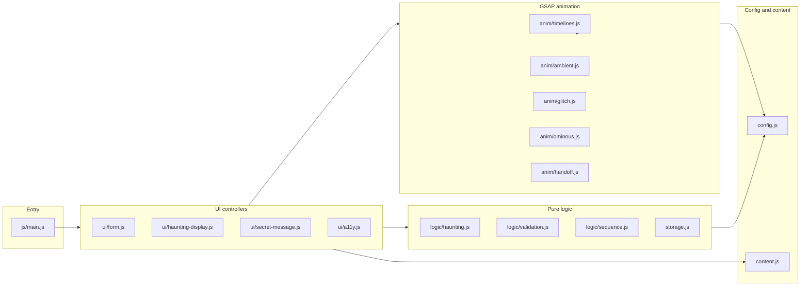
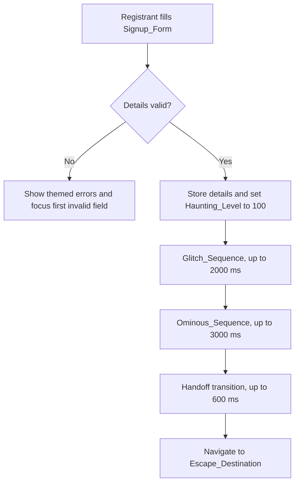

# Design Document

## Overview

Haunted_Page is a single scrolling Halloween event page built with only HTML, CSS, JavaScript, and GSAP. A visitor descends from a calm, eerie Hero_Section to a Signup_Form at the bottom. The interface grows more haunted as the visitor scrolls and completes the form, and that haunting doubles as feedback (candles light for valid fields, whispers carry validation errors, the Haunting_Level display shows overall progress). A valid submission triggers a staged glitching error, an ominous mood, and a handoff to a separate escape experience that is specified in its own spec.

### Key Design Decisions

- **Vanilla stack only.** Static files, ES modules, no framework, no CSS utility library, no bundler. GSAP is vendored locally or loaded from one pinned URL.
- **Pure logic is separated from the DOM.** Haunting_Level, validation, the sequence state machine, and storage are plain functions in `js/logic/` and `js/storage.js`. They run in Node for property-based tests with no browser.
- **GSAP owns all motion.** Every animation comes from a timeline factory in `js/anim/`, with durations and easing defined in one module (`js/anim/timelines.js`).
- **One explicit state machine drives the signup flow.** `idle -> glitch -> ominous -> handoff -> done`, with a reducer that ignores out-of-order events, so the sequence and navigation happen exactly once.
- **Visuals are CSS and inline SVG.** Fog, spectral shapes, candles, scanlines, and vignettes are HTML elements styled by CSS custom properties and animated by GSAP.
- **Reduced motion and flash safety are first-class.** One module reads the preference, and every timeline factory takes it into account.
- **The escape is a black box.** The page only knows a destination URL from `js/config.js` and a sessionStorage key for the Signup_Details.

## Architecture

### Layers



### Signup Flow



### Project Layout

```
index.html
css/
  tokens.css        design tokens (custom properties)
  base.css          reset, typography, focus styles
  sections.css      hero, details, signup, form, secret message
  effects.css       fog, candles, scanlines, vignette, ominous grade
js/
  main.js           bootstrap and wiring
  config.js         constants (destination URL, storage key, limits)
  content.js        all themed copy (errors, hidden message, labels)
  storage.js        sessionStorage read and write for Signup_Details
  logic/
    haunting.js     Haunting_Level and effect scaling
    validation.js   Signup_Details validation
    sequence.js     sequence state machine (reducer)
  anim/
    timelines.js    shared durations, easing, timeline factories
    ambient.js      Ambient_Effect layers and parallax
    glitch.js       Glitch_Sequence timeline
    ominous.js      Ominous_Sequence timeline
    handoff.js      Handoff transition timeline
  ui/
    form.js         Signup_Form behavior and sequence orchestration
    haunting-display.js  Haunting_Level display and candle indicators
    secret-message.js    Secret_Message_Button behavior
    a11y.js         reduced-motion preference and live-region announcer
vendor/gsap/        GSAP and plugins (or a pinned CDN URL in README)
tests/              unit and property-based tests
.kiro/
  steering/         design-language.md, code-conventions.md
  hooks/            lint-on-save and verify-deps hooks
```

## Components and Interfaces

### `js/config.js`

```js
export const ESCAPE_DESTINATION = './escape/index.html'; // single place to change the destination
export const DETAILS_STORAGE_KEY = 'haunted.signupDetails';
export const LIMITS = {
  timelineMs: 2000,
  ominousMs: 3000,
  handoffTransitionMs: 600,
  reducedMotionMs: 300,
  messageMinVisibleMs: 1500,
  handoffStartMaxMs: 5600,
};
export const AMBIENT_MAX = { desktop: 40, mobile: 20 };
export const NAME_MAX_LENGTH = 100;
```

### `js/logic/haunting.js`

```js
computeHauntingLevel({ scrollProgress, validFields, totalFields }) // -> integer 0..100
isIntense(level)                  // -> level > 75
ambientCount(level, max)          // -> integer, strictly larger at 100 than at 1 for max >= 2
ambientSpeed(level)               // -> number, strictly larger at 100 than at 1
```

- `scrollProgress` is clamped to 0..1, and `validFields / totalFields` is clamped to 0..1 (a `totalFields` of 0 counts as 0).
- Level = `min(100, round(60 * scrollProgress + 40 * validRatio))`.
- `ambientCount = ceil(max * (0.2 + 0.8 * level / 100))`.
- `ambientSpeed = 1 + level / 50`.

### `js/logic/validation.js`

```js
validateName(value)      // -> { valid: boolean, errorKey?: 'nameEmpty' | 'nameTooLong' }
validateEmail(value)     // -> { valid: boolean, errorKey?: 'emailInvalid' }
validateDetails({ name, email }) // -> { valid: boolean, fields: { name, email } }
```

- A name is valid when its trimmed length is 1 to 100 characters.
- An email is valid when it matches a documented simple pattern (one `@`, non-empty local part, domain with a dot, no whitespace).
- Error keys map to themed copy in `js/content.js`.

### `js/logic/sequence.js`

Pure reducer for the post-submit flow.

```js
initialState()                          // -> { phase: 'idle' }
reduce(state, event)                    // -> { state, command }
// events:   SUBMIT_VALID, GLITCH_DONE, OMINOUS_DONE, HANDOFF_DONE, SKIP_GLITCH
// commands: START_GLITCH, START_OMINOUS, START_HANDOFF, NAVIGATE, NONE
phaseLimitMs(phase, reducedMotion)      // -> max duration for a phase
```

Transition table:

| From | Event | To | Command |
|---|---|---|---|
| idle | SUBMIT_VALID | glitch | START_GLITCH |
| glitch | GLITCH_DONE or SKIP_GLITCH | ominous | START_OMINOUS |
| ominous | OMINOUS_DONE | handoff | START_HANDOFF |
| handoff | HANDOFF_DONE | done | NAVIGATE |
| any other combination | any | unchanged | NONE |

### `js/storage.js`

```js
saveDetails(details)   // writes JSON to sessionStorage; returns boolean success
loadDetails()          // returns details or null
```

Both calls are wrapped in try/catch so a blocked or full storage never breaks the flow, and nothing is sent over the network.

### `js/anim/timelines.js`

Single source for durations and easing, and the factories that build GSAP timelines.

```js
getLimits(reducedMotion)             // -> effective duration limits
createHeroEntrance(targets, opts)    // staggered text reveal
createSectionReveal(section, opts)   // ScrollTrigger-backed reveal
createIntensify(targets, level, opts)// plays when Haunting_Level increases
createSecretReveal(el, opts)         // hidden message reveal, up to 2000 ms
```

Every factory returns a GSAP timeline whose total duration is at most the limit from `getLimits`. In reduced-motion mode the duration is capped at 300 ms and continuous motion is replaced by an instant state change.

### `js/anim/ambient.js`

Creates fog and spectral-shape layers (at least two parallax layers) from DOM elements and inline SVG. It scales the active element count with `ambientCount` and the motion speed with `ambientSpeed`, caps elements at `AMBIENT_MAX` for the viewport, and pauses looping tweens when elements leave the viewport or `document.hidden` is true.

### `js/anim/glitch.js`

`createGlitch({ reducedMotion })` returns a timeline that runs at most 2000 ms and combines at least three effects:

| Effect | Technique |
|---|---|
| RGB channel split | Duplicate text layers with colored `text-shadow` or `filter`, offset on a jittering tween |
| Horizontal jitter | Rapid `x` offsets on page sections |
| Screen tearing | Clipped horizontal bands translated by different amounts |
| Scanlines | Repeating-gradient overlay fading in |
| Text corruption | Character scramble on the themed error message |

Planned beats (normal motion): 0 to 300 ms jitter begins, 300 to 900 ms RGB split and tearing, 900 to 1500 ms scanlines and text corruption of the error message, 1500 to 1800 ms settles into the error state.

Flash safety: no more than three light-dark transitions per second and no full-screen saturated red flash. A "Skip" control calls `timeline.progress(1)` and dispatches `SKIP_GLITCH`. With reduced motion, `createGlitch` returns a timeline of at most 300 ms that shows a static, non-flashing error state.

### `js/anim/ominous.js`

`createOminous({ reducedMotion })` returns a timeline of at most 3000 ms (normal motion):

1. 0 to 600 ms: color grade shifts to a deep, desaturated tone.
2. 0 to 1200 ms: vignette tightens and Signup_Form fades out.
3. 0 to 2000 ms: Ambient_Effect speed eases down.
4. 500 to 2800 ms: ominous message remains visible, giving at least 1500 ms of readable time.

With reduced motion, the state change takes at most 300 ms, and a timer holds the message for at least 1500 ms before the Handoff begins.

### `js/anim/handoff.js`

`createHandoff({ reducedMotion })` returns a timeline of at most 600 ms (300 ms reduced) that fades the page to black. When it completes, the controller dispatches `HANDOFF_DONE` and navigates to `ESCAPE_DESTINATION`.

### UI Controllers

- **`ui/form.js`**: Validates fields on blur and submit, renders themed error messages, focuses the first invalid field, and on a valid submit saves details, sets the Haunting_Level to 100, and runs the sequence by feeding events to `reduce` and executing each returned command. It disables the signup button while the sequence runs.
- **`ui/haunting-display.js`**: Listens to scroll and field validity, calls `computeHauntingLevel`, updates the numeric display and the candle indicators (the non-color cues), triggers `createIntensify` on increases, applies the extra effect class above level 75, and announces crossing 75.
- **`ui/secret-message.js`**: Toggles the hidden message with `createSecretReveal`, closes on a second activation or the Escape key, returns focus to the button, and announces the message through a live region.
- **`ui/a11y.js`**: Exposes `prefersReducedMotion()` (with a change listener) and `announce(message)`, which writes to a polite ARIA live region.

### `js/main.js`

Imports the modules, checks that GSAP loaded, registers GSAP plugins, plays the hero entrance, creates ambient layers, wires the UI controllers, and handles the `pageshow` event for back-forward cache restores.

## Data Models

```js
/** @typedef {{ name: string, email: string }} SignupDetails */

/** @typedef {{ valid: boolean, errorKey?: string }} FieldResult */

/** @typedef {{ valid: boolean, fields: { name: FieldResult, email: FieldResult } }} ValidationResult */

/** @typedef {'idle'|'glitch'|'ominous'|'handoff'|'done'} SequencePhase */

/** @typedef {{ phase: SequencePhase }} SequenceState */
```

Haunting_Level effect tiers:

| Level | Tier | Visual behavior |
|---|---|---|
| 0 to 25 | Calm | Soft fog, slow candle flicker |
| 26 to 50 | Uneasy | More fog layers, faster drift |
| 51 to 75 | Haunted | Spectral shapes appear, headings subtly shake |
| 76 to 100 | Frenzied | All Ambient_Effect elements shown, plus extra effects (vignette pulse, chromatic edges, whisper text) |

## Accessibility Design

- **Reduced motion:** `a11y.js` reads `prefers-reduced-motion` and exposes it to every factory. Continuous Ambient_Effect motion stops, the glitch becomes a static error state, and every timeline is capped at 300 ms.
- **Flash safety:** Glitch beats are limited to three transitions per second with no saturated red full-screen flashes. A pre-warning appears next to the signup button, and a skip control is available during the glitch.
- **Keyboard:** All controls are native elements (`button`, `input`, `label`) with a visible `:focus-visible` outline defined in `css/base.css`.
- **Screen readers:** A polite live region announces validation errors, crossing Haunting_Level 75, the glitch starting, and the handoff beginning. The hidden message is announced when it appears.
- **Contrast:** Text and surface token pairs are chosen to keep at least 4.5:1 at every tier and during the glitch and ominous states. Distorting effects apply to decorative layers and not to the text's own color or background.
- **Semantic structure:** Landmarks, ordered headings, and labeled controls.

## Error Handling

| Situation | Handling |
|---|---|
| GSAP fails to load | `main.js` adds a `no-gsap` class, skips animation, keeps content and the form usable, and runs the sequence with timers so the handoff still occurs |
| sessionStorage blocked or full | `saveDetails` returns false; the flow continues without stored details |
| Invalid form input | Reject submission, show themed errors, focus first invalid field |
| Repeated submit | The reducer ignores `SUBMIT_VALID` outside `idle`; the button is also disabled |
| Page restored from back-forward cache | `pageshow` with `persisted` resets to the calm initial state and does not replay the sequence |
| Missing or empty destination constant | Log a console error and stay on the ominous state instead of navigating to a broken URL |

## Correctness Properties

*A property is a characteristic that should hold across all valid executions. These become the property-based tests.*

### Property 1: Haunting_Level is monotonic in its inputs
*For any* two pairs of inputs where the first pair's scroll progress and valid-field count are each less than or equal to the second pair's, the first pair's Haunting_Level is less than or equal to the second pair's.
**Validates: Requirements 4.1, 14.1**

### Property 2: Haunting_Level is a bounded integer
*For any* scroll progress and valid-field count (including out-of-range values), `computeHauntingLevel` returns an integer from 0 to 100 inclusive.
**Validates: Requirements 4.1, 14.2**

### Property 3: Validation is deterministic and exact
*For any* name and email strings, `validateDetails` returns the same result on repeated calls, and returns valid exactly when the trimmed name is 1 to 100 characters and the email matches the documented pattern.
**Validates: Requirements 5.3, 14.3**

### Property 4: The sequence and handoff run exactly once
*For any* sequence of events fed to the reducer, `START_GLITCH` is emitted at most once, `NAVIGATE` is emitted at most once, and when the phase reaches `done` each was emitted exactly once.
**Validates: Requirements 5.6, 14.4**

### Property 5: Phases are ordered and bounded
*For any* sequence of events, the phases visited form a prefix of `idle, glitch, ominous, handoff, done` in that order, and for every phase `phaseLimitMs` is at most 2000 ms (3000 ms for ominous, 600 ms for handoff) in normal motion and at most 300 ms in reduced motion.
**Validates: Requirements 3.2, 6.3, 7.3, 10.2, 14.5**

### Property 6: Storage round trip preserves details
*For any* valid Signup_Details, saving them and loading them returns equivalent Signup_Details.
**Validates: Requirements 5.7, 14.6**

Additional example-based checks cover Ambient_Effect scaling (count and speed at level 100 exceed those at level 1 for the configured maximum) and the above-75 threshold, validating Requirements 4.3 and 4.4.

## Testing Strategy

- **Property-based tests:** Use fast-check with at least 100 iterations per property, run through Node's built-in test runner, with each test tagged `Feature: spooky-haunting-ui, Property N: <text>`. Storage tests use an in-memory sessionStorage stub.
- **Unit tests:** Cover validation edge cases (100 versus 101 characters, whitespace-only names, odd emails), the reducer transition table, the timeline duration limits in both motion modes, and the ambient scaling helpers.
- **Linting:** ESLint for JS, Stylelint for CSS, and an HTML validator, all enforcing the steering guides and run by the PostFileSave hook.
- **Manual and browser checks (not automated):** Frame rate with all effects active, first render time, text contrast at each tier and during the glitch, flash rate during the glitch, keyboard-only walkthrough, and a screen reader pass.

## Requirements Traceability

| Requirement | Main components |
|---|---|
| 1 Technology constraints | Project layout, `config.js`, README |
| 2 Landing experience | `index.html`, `css/*`, `timelines.js`, `ambient.js` |
| 3 GSAP animation system | `anim/*`, `timelines.js` |
| 4 Haunting as function | `haunting.js`, `haunting-display.js`, `ambient.js` |
| 5 Signup form | `validation.js`, `form.js`, `storage.js` |
| 6 Glitch and ominous mood | `glitch.js`, `ominous.js`, `sequence.js` |
| 7 Transport to the escape | `handoff.js`, `sequence.js`, `config.js` |
| 8 Secret message button | `secret-message.js`, `content.js` |
| 9 Performance | `ambient.js`, `timelines.js`, `main.js` |
| 10 Accessibility | `a11y.js`, `glitch.js`, `css/base.css` |
| 11 to 13 Kiro workflow, hooks, steering | `.kiro/`, linters |
| 14 Property-based testing | `tests/`, `logic/*`, `storage.js` |