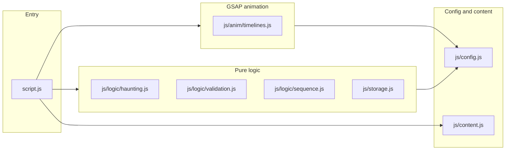
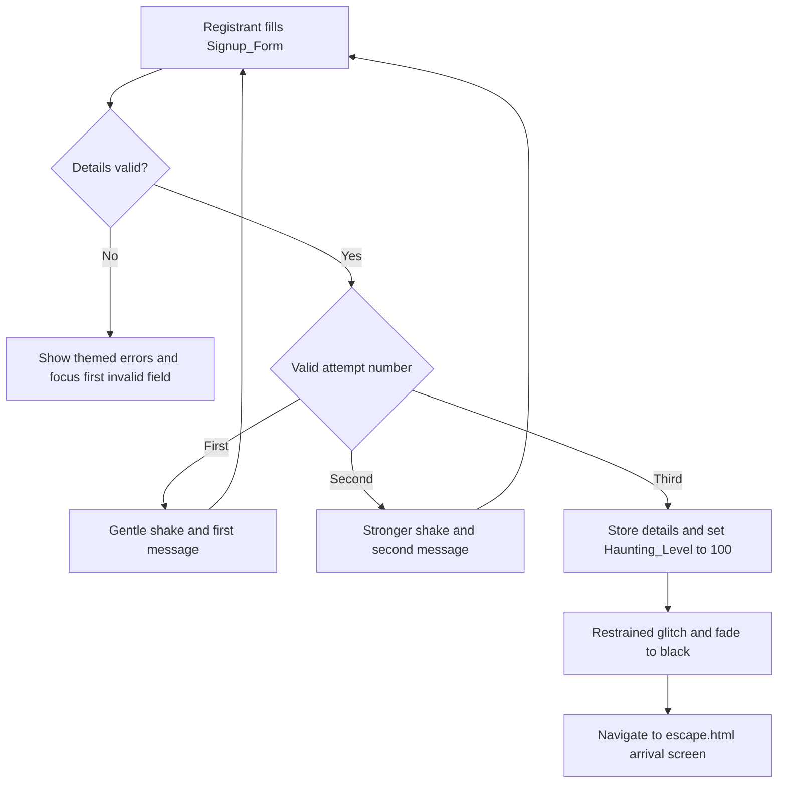

# Design Document

## Overview

Haunted_Page is a single scrolling Halloween event page built with only HTML, CSS, JavaScript, and GSAP. A visitor descends from a calm, eerie Hero_Section to a Signup_Form at the bottom. The interface grows more haunted as the visitor scrolls and completes the form, and that haunting doubles as feedback (candles light for valid fields, whispers carry validation errors, the Haunting_Level display shows overall progress). The first two valid submissions trigger escalating shakes and distinct messages; the third glitches the screen, fades it to black, and opens the arrival screen in `escape.html`.

### Key Design Decisions

- **Vanilla stack only.** Static files, ES modules, no framework, no CSS utility library, no bundler. GSAP is vendored locally or loaded from one pinned URL.
- **Pure logic is separated from the DOM.** Haunting_Level, validation, the sequence state machine, and storage are plain functions in `js/logic/` and `js/storage.js`. They run in Node for property-based tests with no browser.
- **GSAP owns all motion.** Every animation comes from a timeline factory in `js/anim/`, with durations and easing defined in one module (`js/anim/timelines.js`).
- **One explicit state machine drives the signup flow.** `ready -> shaking -> ready -> shaking -> ready -> crossing -> done`. Only valid submissions count, and an animation temporarily locks the form.
- **Visuals are CSS and inline SVG.** Fog, spectral shapes, candles, scanlines, and vignettes are HTML elements styled by CSS custom properties and animated by GSAP.
- **Reduced motion and flash safety are first-class.** One module reads the preference, and every timeline factory takes it into account.
- **Arrival is the scope boundary.** The destination is configured in `js/config.js`; this slice provides the atmospheric arrival screen, while the playable clue hunt remains future work in the escape spec.
- **The scroll meter reaches its base cap before the footer.** Progress is normalized to the point where the footer enters the viewport; mobile signup spacing provides a short, comfortable scroll runway.

## Architecture

### Layers



### Signup Flow



### Project Layout

```
index.html
escape.html         arrival threshold for the escape experience
style.css           shared responsive styles and arrival screen
script.js           signup, navigation, accessibility, and visual wiring
gsap.min.js         local GSAP runtime
js/
  config.js         destination, timing, and ambient limits
  content.js        themed copy
  storage.js        sessionStorage for Signup_Details
  logic/            pure haunting, validation, and sequence logic
  anim/timelines.js shared GSAP timeline factories
tests/              unit and property-based tests
.kiro/
  steering/         design-language.md, code-conventions.md
  hooks/            lint-on-save and verify-deps hooks
```

## Components and Interfaces

### `js/audio/sound-effects.js`

Exports `playSignupError()` for a restrained descending validation cue and `playCrossingSound(reducedMotion)` for an original low synth swell with a higher signal tone. Both use the browser's Web Audio API, create the audio context only after the user activates a form control, and no-op when the API is unsupported or blocked. They load no remote media. The crossing sound starts synchronously with the third submit interaction so browser audio policies allow it to play through the glitch and fade; the reduced-motion version is brief.

### `js/config.js`

```js
export const ESCAPE_DESTINATION = './escape.html'; // single place to change the destination
export const TIMING = {
  shakeFirst: 620,
  shakeSecond: 900,
  glitch: 1050,
  handoff: 600,
  reduced: 250,
};
export const MAX_AMBIENT_EFFECTS = 8;
```

`ESCAPE_DESTINATION` is `./escape.html`. `SIGNUP_STORAGE_KEY` is `nocturne-night:signup` and is declared in `js/content.js`.

### `js/logic/haunting.js`

```js
computeHauntingLevel({ scrollProgress, validFields, totalFields }) // -> integer 0..100
isIntense(level)                  // -> level > 75
ambientCount(level, max)          // -> integer, strictly larger at 100 than at 1 for max >= 2
ambientSpeed(level)               // -> number, strictly larger at 100 than at 1
```

- `scrollProgress` is clamped to 0..1, and `validFields / totalFields` is clamped to 0..1 (a `totalFields` of 0 counts as 0).
- Level = `min(100, round(60 * scrollProgress + 40 * validRatio))`.
- `scrollProgress` is `scrollY / max(footerDocumentTop - viewportHeight, 1)`, clamped to 0..1. If the footer-entry point is not scrollable, use the document's maximum scroll distance.
- At the footer-entry point with no valid fields, the score is 60. Each valid field adds 20; the third valid submit sets the score to 100.
- `ambientCount = ceil(max * (0.2 + 0.8 * level / 100))`.
- `ambientSpeed = 1 + level / 50`.

### `js/logic/validation.js`

```js
validateName(value)      // -> { valid: boolean, errorKey?: 'nameEmpty' | 'nameTooLong' }
validateEmail(value)     // -> { valid: boolean, errorKey?: 'emailInvalid' }
validateDetails({ name, email }) // -> { valid: boolean, fields: { name, email } }
```

- A name is valid when its trimmed length is 1 to 100 characters.
- An email is valid when it matches a documented simple pattern (one `@`, non-empty local part, domain with a dot, no whitespace).
- Error keys map to themed copy in `js/content.js`.

### `js/logic/sequence.js`

Pure reducer for the post-submit flow.

```js
initialState                            // { phase: 'ready', attempts: 0 }
reduce(state, { type: 'VALID_SUBMIT' }) // increments valid attempt; third enters crossing
reduce(state, { type: 'ANIMATION_DONE' }) // returns shaking phase to ready
reduce(state, { type: 'CROSSING_DONE' })   // completes the final handoff
```

Transition table:

| From | Event | To | Attempts |
|---|---|---|---:|
| ready | VALID_SUBMIT (attempts 0 or 1) | shaking | +1 |
| shaking | ANIMATION_DONE | ready | unchanged |
| ready | VALID_SUBMIT (attempt 2) | crossing | 3 |
| crossing | CROSSING_DONE | done | unchanged |
| any other combination | any | unchanged | unchanged |

### `js/storage.js`

```js
saveDetails(details)   // writes JSON to sessionStorage; returns boolean success
loadDetails()          // returns details or null
```

Both calls are wrapped in try/catch so a blocked or full storage never breaks the flow, and nothing is sent over the network.

### `js/anim/timelines.js`

`createTimelines(gsap, reducedMotion, elements)` is the single shared factory for the current implementation. It provides hero and section reveals, ambient motion, escalating signup shakes, a final glitch with brief blocky pixel tears and horizontal scanlines, the fade to black, and an arrival-title zoom-out reveal. The final handoff takes at most 600 ms (250 ms with reduced motion). The pixel layer is decorative and hidden from assistive technology.

### `js/anim/ambient.js`

Creates fog and spectral-shape layers (at least two parallax layers) from DOM elements and inline SVG. It scales the active element count with `ambientCount` and the motion speed with `ambientSpeed`, caps elements at `AMBIENT_MAX` for the viewport, and pauses looping tweens when elements leave the viewport or `document.hidden` is true.

`createTimelines(gsap, reducedMotion, elements)` is the actual shared factory. It provides a gentle first `shake(attempt)`, a stronger second shake, a final `glitch()` with brief pixel-block breakup, a `handoff()` fade to black, and an `arrivalTitle()` zoom-out reveal. The final transition is capped at 600 ms (250 ms when reduced motion is enabled). The entry script provides timeout and CSS fallbacks when GSAP is unavailable.

### UI Controllers

- **`script.js`**: Validates fields on blur and submit, renders themed errors, counts valid attempts through `reduce`, announces each message, and controls the shake, final glitch, storage, and navigation. It disables the form during each animation and enables it again after the first two.
- **`script.js` haunting display:** Listens to scroll and field validity, updates the numeric display and candles, scales ambient effects, and announces thresholds.
- **`script.js` secret message:** Toggles the hidden message, supports Escape and focus return, and announces it through the live region.
- **`script.js` accessibility:** Reads reduced-motion preference and announces validation and transition status.

### `script.js`

Imports the pure logic and timeline factory, wires browser events, and provides the missing-GSAP and reduced-motion paths.

## Data Models

```js
/** @typedef {{ name: string, email: string }} SignupDetails */

/** @typedef {{ valid: boolean, errorKey?: string }} FieldResult */

/** @typedef {{ valid: boolean, fields: { name: FieldResult, email: FieldResult } }} ValidationResult */

/** @typedef {'ready'|'shaking'|'crossing'|'done'} SequencePhase */

/** @typedef {{ phase: SequencePhase, attempts: number }} SequenceState */
```

Haunting_Level effect tiers:

| Level | Tier | Visual behavior |
|---|---|---|
| 0 to 25 | Calm | Soft fog, slow candle flicker |
| 26 to 50 | Uneasy | More fog layers, faster drift |
| 51 to 75 | Haunted | Spectral shapes appear, headings subtly shake |
| 76 to 100 | Frenzied | All Ambient_Effect elements shown, plus extra effects (vignette pulse, chromatic edges, whisper text) |

## Accessibility Design

- **Reduced motion:** `script.js` reads `prefers-reduced-motion`. Ambient motion stops and shaking/glitch/title movement is omitted while messages and a short dark handoff remain.
- **Flash safety:** The final glitch uses restrained scanline movement and hue shift without saturated red full-screen flashes. A skip control is available during the final crossing.
- **Keyboard:** All controls are native elements (`button`, `input`, `label`) with visible focus outlines in `style.css`.
- **Screen readers:** A polite live region announces validation errors, crossing Haunting_Level 75, the glitch starting, and the handoff beginning. The hidden message is announced when it appears.
- **Contrast:** Text and surface token pairs keep at least 4.5:1 at every tier and during the final transition. Distorting effects apply to decorative layers and not to the text's own color or background.
- **Semantic structure:** Landmarks, ordered headings, and labeled controls.

## Error Handling

| Situation | Handling |
|---|---|
| GSAP fails to load | `script.js` uses timeout and CSS fallbacks, keeps the form usable, and completes the handoff |
| sessionStorage blocked or full | `saveDetails` returns false; the flow continues without stored details |
| Invalid form input | Reject submission, show themed errors, focus first invalid field |
| Web Audio unsupported or blocked | Continue all form and crossing behavior silently |
| Repeated submit | The reducer ignores events outside `ready`; the button is disabled during each animation |
| Page restored from back-forward cache | The sequence is not automatically restarted; a fresh navigation begins at the initial state |
| Missing or empty destination constant | Keep the landing page visible rather than navigating to a broken URL |

## Correctness Properties

*A property is a characteristic that should hold across all valid executions. These become the property-based tests.*

### Property 1: Haunting_Level is monotonic in its inputs
*For any* two pairs of inputs where the first pair's scroll progress and valid-field count are each less than or equal to the second pair's, the first pair's Haunting_Level is less than or equal to the second pair's.
**Validates: Requirements 4.1, 14.1**

### Property 2: Haunting_Level is a bounded integer
*For any* scroll progress and valid-field count (including out-of-range values), `computeHauntingLevel` returns an integer from 0 to 100 inclusive.
**Validates: Requirements 4.1, 14.2**

### Property 3: Validation is deterministic and exact
*For any* name and email strings, `validateDetails` returns the same result on repeated calls, and returns valid exactly when the trimmed name is 1 to 100 characters and the email matches the documented pattern.
**Validates: Requirements 5.3, 14.3**

### Property 4: Three valid submissions are required
*For any* sequence of valid and invalid submissions, only valid submissions increment the attempt count; the first two return to `ready` after animation, and only the third enters `crossing`.
**Validates: Requirements 5.5–5.7, 14.4**

### Property 5: Final crossing runs at most once
*For any* sequence of events, `crossing` and `done` can each be entered at most once; the final handoff lasts no more than 600 ms (250 ms with reduced motion).
**Validates: Requirements 3.2, 7.1–7.4, 10.2, 14.5**

### Property 6: Storage round trip preserves details
*For any* valid Signup_Details, saving them and loading them returns equivalent Signup_Details.
**Validates: Requirements 5.7, 14.6**

Additional example-based checks cover Ambient_Effect scaling (count and speed at level 100 exceed those at level 1 for the configured maximum) and the above-75 threshold, validating Requirements 4.3 and 4.4.

## Testing Strategy

- **Property-based tests:** Use fast-check with at least 100 iterations per property, run through Node's built-in test runner, with each test tagged `Feature: spooky-haunting-ui, Property N: <text>`. Storage tests use an in-memory sessionStorage stub.
- **Unit tests:** Cover validation edge cases (100 versus 101 characters, whitespace-only names, odd emails), the reducer transition table, the timeline duration limits in both motion modes, and the ambient scaling helpers.
- **Kiro hook review:** The PostFileSave hook checks the three-attempt transition and scope against the specs and steering. It reports mismatches and runs no undeclared commands.
- **Manual and browser checks (not automated):** Frame rate with all effects active, first render time, text contrast at each tier and during the glitch, flash rate during the glitch, keyboard-only walkthrough, and a screen reader pass.
- **Audio checks (manual):** Submit invalid data and confirm exactly one quiet error cue; complete the third valid submission and confirm the original synth cue begins with the black handoff; verify both flows continue when Web Audio is unavailable and that the reduced-motion crossing cue is short.

## Requirements Traceability

| Requirement | Main components |
|---|---|
| 1 Technology constraints | Project layout, `config.js`, README |
| 2 Landing experience | `index.html`, `style.css`, `js/anim/timelines.js` |
| 3 GSAP animation system | `js/anim/timelines.js` |
| 4 Haunting as function | `haunting.js`, `haunting-display.js`, `ambient.js` |
| 5 Signup form | `validation.js`, `form.js`, `storage.js` |
| 6 Final glitch and crossing | `js/anim/timelines.js`, `js/logic/sequence.js` |
| 7 Transport to the escape | `js/anim/timelines.js`, `js/logic/sequence.js`, `js/config.js` |
| 8 Secret message button | `secret-message.js`, `content.js` |
| 9 Performance | `ambient.js`, `timelines.js`, `main.js` |
| 10 Accessibility | `script.js`, `style.css` |
| Signup and crossing sound cues | `js/audio/sound-effects.js`, `script.js` |
| 11 to 13 Kiro workflow, hooks, steering | `.kiro/` |
| 14 Property-based testing | `tests/`, `logic/*`, `storage.js` |
