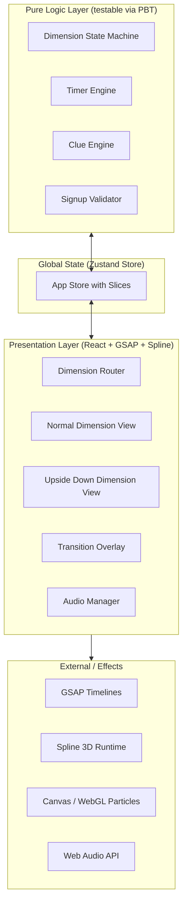
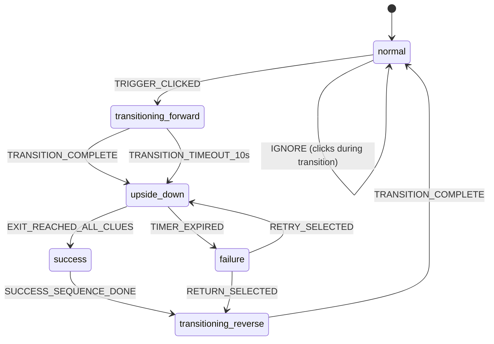
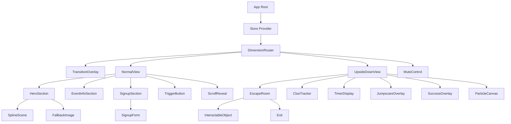

# Design Document

## Overview

The Upside Down Escape is a dual-dimension, Halloween-themed web application built for the Kiroween 2026 Hackathon (Costume Contest / Haunting UI track). The application presents a polished festive Halloween event landing page (the "Normal Dimension") enriched with Spline 3D elements and GSAP scroll animations, hiding a tempting animated button at the bottom that transports the user into a Stranger Things-inspired "Upside Down" dimension — a dark, eerie escape room where the user must discover clues and escape within a time limit.

The design separates the application into a **pure logic layer** (dimension state machine, timer, clue tracking, signup validation) and a **presentation layer** (React components, GSAP animations, Spline 3D, Canvas particle effects, Web Audio). This separation is the cornerstone of the architecture: it keeps complex state transitions testable via property-based testing while the visual richness lives in the UI layer.

**Key Design Decisions:**
- **Next.js App Router** as the application framework for routing, SSR, and code splitting.
- **Zustand** for global state management (lightweight, no boilerplate, ideal for a hackathon) with a single store composed of slices.
- **GSAP timelines** drive all cinematic dimension transitions, with the `useGSAP()` hook handling cleanup automatically.
- **Spline** renders the hero 3D element, with a static fallback image when the scene fails to load.
- **fast-check** for property-based testing of the pure logic layer (state machines, validation, timer).
- A strict **logic/UI boundary** so that every correctness property operates on pure functions that have no React or DOM dependencies.

## Architecture

### High-Level Architecture

The application follows a layered architecture with a clear separation between logic and presentation:



The pure logic layer contains framework-agnostic TypeScript modules that encode the rules: which dimension transitions are legal, how the timer decrements, how clue discovery affects progress, and how signup data is validated. These modules are pure functions of their inputs and are the sole subjects of property-based tests. The Zustand store wires these logic modules to the React presentation layer, and the presentation layer issues side effects (animations, audio, 3D rendering) in response to state changes.

### Dimension State Machine

The core of the application is a finite state machine governing which dimension is active and what transitions are permitted. This state machine is implemented as a pure reducer function so it can be tested exhaustively with property-based testing.



States:
- `normal` — the Halloween landing page is active (initial state on page load/reload).
- `transitioning_forward` — forward transition animation playing (Normal → Upside Down). All controls except the transition surface are disabled.
- `upside_down` — the escape room is active, timer running.
- `success` — user reached the exit with all clues; success message and audio play before reverse transition.
- `failure` — timer reached zero; jumpscare plays, then retry/return options shown.
- `transitioning_reverse` — reverse transition animation playing (Upside Down → Normal).

The reducer accepts a current state and an event, and returns the next state. Illegal transitions (e.g., clicking the trigger while already transitioning) are ignored — the state is returned unchanged. This guard satisfies Requirement 4.6 (concurrent-click guard) and Requirement 3.4 (control lockdown is enforced by the UI reading the `transitioning_*` states).

### Routing Strategy

The current dimension state is reflected in the URL without a full page reload:
- `normal` → `/` (root path)
- `upside_down` (and its sub-states) → `/upside-down`

On initial page load or reload, the application always resets to the `normal` dimension regardless of the URL, satisfying Requirement 13.3. The URL is updated via `history.pushState` (or Next.js router shallow navigation) when a transition completes, not when it begins, so a reload mid-transition cleanly returns to `normal`. Signup registration state is held in the Zustand store (and persisted to `sessionStorage`) so it survives dimension transitions, satisfying Requirement 13.4.

### Animation Architecture

Two distinct animation systems coexist:

**1. GSAP Scroll Animations (Normal Dimension):**
Each section of the Normal Dimension is registered with a GSAP `ScrollTrigger` attached to a top-level tween (per [GSAP best practices](https://github.com/greensock/gsap-skills/blob/main/.github/copilot-instructions.md)). When a section enters the viewport, the tween reveals it with motion and fade. All setup happens inside the `useGSAP()` hook from `@gsap/react`, which automatically reverts animations and ScrollTriggers on unmount ([GSAP React docs](https://gsap.com/resources/React)). A `gsap.context()` with `{ scope }` restricts selector text to the component subtree.

**2. GSAP Transition Timelines (Dimension Transitions):**
The Transition Overlay uses a master GSAP timeline per transition direction. Each timeline is a sequence of tweens:
- **Forward:** darken/distort source visuals (vignette intensify, filter blur/scale) → crossfade → reveal destination with distortion settling.
- **Reverse:** symmetric sequence returning to Normal.

Timeline duration is randomized within the 2–4s window (forward: Req 4.1; reverse on escape success: 2–3s per Req 9.3). A 10s watchdog timer forces completion if the timeline stalls (Req 3.6). Audio cues are scheduled with `gsap.timeline().call()` callbacks positioned within 200ms of the visual start/end, satisfying the audio sync tolerance (Req 4.2). A single `transitionLock` ref prevents concurrent transitions (Req 4.6).

**3. Spline 3D (Hero Section):**
The hero renders a Spline scene via the `<Spline>` component. For Next.js App Router, the import comes from `@splinetool/react/next` so the server renders a blurred placeholder and the client hydrates the 3D scene ([@splinetool/react-spline](https://www.npmjs.com/package/@splinetool/react-spline)). An `onError` handler swaps in a static fallback image (Req 1.6). The scene URL points to a self-hosted `.splinecode` file to avoid CORS issues.

**4. Canvas/WebGL Particle Effects (Upside Down):**
A `<canvas>` element renders floating ash/particle motes and fog using requestAnimationFrame. This is decoupled from React state (pure rendering loop) and pauses when the Upside Down dimension is not active to save resources.

### Audio Management System

A centralized `AudioManager` (singleton) wraps the Web Audio API / HTML5 audio elements. It exposes:
- `playCue(name)` — plays a named cue (transition, clue-discovery, jumpscare, success, ambient-loop).
- `setMuted(boolean)` — toggles a master gain node; the muted state is persisted to `localStorage` and read on init so it survives dimension transitions (Req 11.4).
- `preload(name)` — fetches and decodes audio buffers for the jumpscare so playback starts within 100ms of the trigger (Req 12.4, 12.5).

Ambient audio loops while the Upside Down dimension is active and stops on transition out. All cues respect the master mute. The mute control is rendered in both dimensions and wired to the same `AudioManager` instance.

### Asset Loading Strategy

- **Lazy loading:** The Spline scene, GSAP plugins, and the entire Upside Down dimension bundle are code-split via Next.js dynamic imports (`next/dynamic`) so they only load when needed. Below-the-fold sections use `loading="lazy"` for images. This satisfies Requirement 12.3.
- **Preloading:** When the user is in the Normal Dimension, the `AudioManager.preload('jumpscare')` fetches and decodes the jumpscare animation frames and audio so that on failure they are already in memory (Req 12.4). The jumpscare video/animation assets are prefetched via `<link rel="preload">`.
- **Initial render priority:** The hero content (title, description, static fallback image) renders immediately; the Spline 3D scene hydrates asynchronously so the 3-second hero load target (Req 12.1) is met even on slow connections.

## Components and Interfaces

### Component Hierarchy



### Component Specifications

#### `App` (Root)
- **Responsibility:** Wraps the application in the Zustand store provider and renders the `DimensionRouter`.
- **Props:** none.
- **State:** initializes the store, reads persisted signup + audio-muted state.

#### `DimensionRouter`
- **Responsibility:** Reads the current dimension state from the store and renders the appropriate view. Manages URL updates via `history.pushState`. Enforces control lockdown when a transition is in progress (disables pointer events on the inactive dimension).
- **Props:** none (subscribes to store).
- **Key logic:** Maps store dimension state → which view is visible. On mount, resets to `normal` (Req 13.3).

#### `TransitionOverlay`
- **Responsibility:** Full-screen overlay that plays the GSAP transition timeline. Positioned `fixed` with a high z-index. Drives the dimension swap at the midpoint of the timeline.
- **Props:** `direction: 'forward' | 'reverse'`, `onComplete: () => void`.
- **Key logic:** Builds a GSAP timeline scoped to its own ref. On the forward direction, darkens/distorts the source, then reveals the destination. Emits `onComplete` (which dispatches `TRANSITION_COMPLETE` to the store). A 10s `setTimeout` watchdog calls `onComplete` if the timeline hasn't fired (Req 3.6). Ignores clicks via a `transitionLock` (Req 4.6).

#### `NormalView` (Normal Dimension)
- **Sub-components:**
  - `HeroSection` — renders the event title, description (≤200 chars), and the Spline 3D scene. Contains `SplineScene` and a `FallbackImage` shown when the scene errors. Sets `alt`/`aria-label` on the 3D container for accessibility (Req 11.1).
  - `EventInfoSection` — renders event date, location, time, and description.
  - `SignupSection` — wraps `SignupForm`.
  - `TriggerButton` — positioned at the bottom of the page below all primary content (Req 3.1). Continuously loops a pulsing-glow / animated-text cue via GSAP without explicit destination text (Req 3.2). On click, dispatches `TRIGGER_CLICKED`.
  - `ScrollReveal` — a wrapper that registers a GSAP `ScrollTrigger` for each section, revealing on viewport entry (Req 1.4).

#### `SignupForm`
- **Responsibility:** Collects name (max 100), email (max 254), and optional plus-one count (0–10). Validates on submit and displays field-specific errors. On success, shows a confirmation and clears fields. On duplicate email, shows an error and retains fields. On server/network error, retains all values (Req 2.x).
- **Props:** none (reads/writes the signup store slice).
- **Validation logic:** Delegates to the pure `validateSignup` function (see Logic Modules). The form calls `validateSignup(input)` and renders returned errors. The duplicate-email check consults the signup store's registered-emails set.

#### `UpsideDownView` (Upside Down Dimension)
- **Sub-components:**
  - `EscapeRoom` — renders the environment with particle effects, fog, dark blue/grey palette (Req 5.1). Contains `InteractableObject` instances and an `Exit`.
  - `InteractableObject` — a clickable/tappable element. On interaction, dispatches `INTERACT` to the clue engine. Receives `id`, `hasClue`, `discovered`, and an `onInteract` callback. Renders focus indicator and is keyboard-activatable (Req 11.2). Min target size 44×44px (Req 10.3).
  - `Exit` — hidden and non-interactive until all clues are discovered (Req 5.3). On reach, dispatches `EXIT_REACHED`. Becomes visible and interactive when the clue tracker shows all discovered.
  - `ClueTracker` — displays "discovered / total" (e.g., "2 / 4"). Reads from the clue store slice. Updates on each discovery (Req 6.2).
  - `TimerDisplay` — shows remaining time in MM:SS. Reads from the timer store slice. Turns red and pulses when < 10s (Req 7.3).
  - `JumpscareOverlay` — full-viewport animation + audio on `failure`. Uses preloaded assets. After completion, shows failure message + retry/return options (Req 8.x).
  - `SuccessOverlay` — success message (≥3s) + audio (3–5s) on `success` (Req 9.2). Then triggers reverse transition.
  - `ParticleCanvas` — `<canvas>` with rAF particle/fog loop. Pauses when not active.

#### `MuteControl`
- **Responsibility:** A always-visible button in both dimensions that toggles the `AudioManager` master mute. Reflects persisted muted state. Activatable via keyboard (Req 11.2, 11.4).

### Logic Modules (Pure Functions)

These modules have no React or DOM dependencies and are the subjects of property-based tests.

#### `dimensionReducer(state, event) → state`
A pure reducer implementing the state machine above. Input: current `DimensionState` and a `DimensionEvent`. Output: next `DimensionState`. Illegal transitions return the state unchanged. This is the heart of the transition concurrency guard and the timeout fallback.

#### `timerEngine(state, tick) → state`
Pure function that decrements the remaining time by 1 second on each `TICK` event. Returns `expired` when reaching zero. Ignores ticks when paused/escaped. Input includes the configurable initial time (60–600s, default 300).

#### `clueEngine(state, event) → state`
Pure reducer for clue discovery. Tracks which clues are discovered and whether all required clues are found. `INTERACT(objectId)` reveals clue content or flavor and increments the discovered count only for actual clues. `allCluesFound` is derived: `discoveredCount === totalClues`.

#### `validateSignup(input) → ValidationResult`
Pure validation function. Returns an object mapping field names to error messages (or empty). Checks: required fields non-empty, name ≤ 100 chars, email ≤ 254 chars, email has local part before `@` and domain after, plus-one between 0–10. Duplicate-email detection is a separate store concern (requires state), so `validateSignup` focuses on format/length; the duplicate check is layered on top in the form handler.

## Data Models

### Dimension State

```typescript
type DimensionState =
  | 'normal'
  | 'transitioning_forward'
  | 'upside_down'
  | 'success'
  | 'failure'
  | 'transitioning_reverse';

type DimensionEvent =
  | { type: 'TRIGGER_CLICKED' }
  | { type: 'TRANSITION_COMPLETE' }
  | { type: 'TRANSITION_TIMEOUT' }
  | { type: 'EXIT_REACHED' }
  | { type: 'TIMER_EXPIRED' }
  | { type: 'SUCCESS_SEQUENCE_DONE' }
  | { type: 'RETRY_SELECTED' }
  | { type: 'RETURN_SELECTED' };
```

### Timer Configuration & State

```typescript
interface TimerConfig {
  initialTimeSeconds: number; // 60–600, default 300
  tickIntervalMs: number;       // 1000
}

interface TimerState {
  remainingSeconds: number;
  isRunning: boolean;
  isExpired: boolean;
}
```

### Clue & Interactable Object Data

```typescript
interface InteractableObjectData {
  id: string;
  hasClue: boolean;
  clueContent: string | null;   // shown when discovered; null if no clue
  flavorContent: string | null; // shown for non-clue objects
  position: { x: number; y: number };
}

interface ClueState {
  totalClues: number;            // 3–5
  discoveredClueIds: string[];   // subset of clue-bearing object ids
  allCluesFound: boolean;        // derived: discoveredClueIds.length === totalClues
}
```

### Signup Registration Data

```typescript
interface SignupInput {
  fullName: string;
  email: string;
  plusOneCount: number | null; // null = not provided (optional)
}

interface ValidationResult {
  errors: Partial<Record<'fullName' | 'email' | 'plusOneCount', string>>;
  isValid: boolean;
}

interface SignupState {
  registeredEmails: Set<string>;
  lastSubmission: 'idle' | 'success' | 'duplicate' | 'error';
  lastInput: SignupInput | null; // retained on error for field preservation
}
```

### Audio State

```typescript
interface AudioState {
  isMuted: boolean;
  activeCues: string[];
}
```


## Correctness Properties

*A property is a characteristic or behavior that should hold true across all valid executions of a system — essentially, a formal statement about what the system should do. Properties serve as the bridge between human-readable specifications and machine-verifiable correctness guarantees.*

The following properties apply to the **pure logic layer** (dimension state machine, timer engine, clue engine, signup validator). The UI rendering, GSAP animations, and audio playback layers are tested via example and integration tests (see Testing Strategy). Each property below is implementable as a fast-check property test running a minimum of 100 iterations.

### Property 1: Dimension state machine transition correctness

*For any* current dimension state and *any* dimension event, the dimension reducer SHALL produce the correct next state when the transition is legal (e.g., `normal` + `TRIGGER_CLICKED` → `transitioning_forward`; `transitioning_forward` + `TRANSITION_COMPLETE` → `upside_down`; `transitioning_forward` + `TRANSITION_TIMEOUT` → `upside_down`; `upside_down` + `EXIT_REACHED` with all clues found → `success`; `success` + `SUCCESS_SEQUENCE_DONE` → `transitioning_reverse`; `transitioning_reverse` + `TRANSITION_COMPLETE` → `normal`; `upside_down` + `TIMER_EXPIRED` → `failure`; `failure` + `RETRY_SELECTED` → `upside_down`; `failure` + `RETURN_SELECTED` → `transitioning_reverse`) and SHALL return the state unchanged when the transition is illegal (e.g., `TRIGGER_CLICKED` in any non-`normal` state).

**Validates: Requirements 3.3, 3.4, 3.5, 3.6, 4.4, 4.5, 4.6, 9.1, 9.3**

### Property 2: Initial dimension state is always normal

*For any* page load or page reload, regardless of the URL path (including `/upside-down`), the dimension state SHALL be initialized to `normal`.

**Validates: Requirements 13.1, 13.3**

### Property 3: Non-dimension state is invariant across dimension transitions

*For any* dimension state transition, the audio muted state and the signup registration state (registered email set and last submission status) SHALL remain unchanged.

**Validates: Requirements 11.4, 13.4**

### Property 4: Timer countdown and freeze correctness

*For any* valid initial time and *any* sequence of tick events, the timer SHALL decrement the remaining time by exactly 1 second per tick while running, SHALL report expired when the remaining time reaches 0, and after an escape or pause event, subsequent ticks SHALL have no effect on the remaining time.

**Validates: Requirements 7.1, 7.4, 7.5**

### Property 5: Timer config validation

*For any* initial time value, the timer configuration SHALL be valid if and only if the value is between 60 and 600 seconds inclusive, and the default value SHALL be 300 seconds.

**Validates: Requirements 7.1**

### Property 6: Clue discovery increments only for undiscovered clue objects

*For any* clue state and *any* interactable object, interacting with the object SHALL increment the discovered count if and only if the object contains a clue and that clue has not already been discovered, and interacting with a non-clue object SHALL never change the discovered count.

**Validates: Requirements 6.1, 6.5**

### Property 7: Exit availability and clue count bounds

*For any* clue state, the exit SHALL be interactive if and only if all required clues have been discovered, the discovered count SHALL never exceed the total clue count, the total clue count SHALL be between 3 and 5 inclusive, and the escape room SHALL contain at least 3 interactable objects.

**Validates: Requirements 5.2, 5.3, 6.2, 6.3**

### Property 8: Signup validation constraints

*For any* signup input, the validator SHALL report an error for exactly the fields that violate their constraints — a required field that is empty, a name exceeding 100 characters, an email exceeding 254 characters, an email missing a local part before the at symbol or a domain part after it, or a plus-one count outside 0 to 10 — and any input satisfying all constraints SHALL produce no errors.

**Validates: Requirements 2.1, 2.2, 2.3, 2.4**

### Property 9: Duplicate email detection

*For any* signup input whose email is already present in the registered email set, the signup state SHALL transition to `duplicate` and SHALL retain the submitted input; for any signup input whose email is not in the registered set and is otherwise valid, the signup state SHALL transition to `success`, the email SHALL be added to the registered set, and the form fields SHALL be cleared.

**Validates: Requirements 2.5**

## Error Handling

### Spline 3D Load Failure
When the Spline scene fails to load (network error, CORS, invalid scene URL), the `onError` handler on the `<Spline>` component swaps in a static fallback image in the hero section (Req 1.6). The error is logged to the console but does not block the rest of the page from rendering. The fallback image uses the same `alt` text as the 3D element would have for accessibility.

### Transition Timeout Fallback
If the forward transition animation does not complete within 10 seconds (Req 3.6), a watchdog `setTimeout` dispatches `TRANSITION_TIMEOUT`, which the dimension state machine maps to `upside_down`. This guarantees the user is never stuck on a transition overlay indefinitely. The same guard applies to reverse transitions.

### Concurrent Click Guard
Clicks on the Trigger_Button (or any transition-initiating control) while a transition is in progress are ignored by the state machine (Req 4.6). The UI layer additionally sets `pointer-events: none` on non-transition surfaces during a `transitioning_*` state to prevent interaction.

### Transition Failure on Escape
If the reverse transition animation on escape fails to complete (Req 9.4), the application displays an error message and retains the user in the current dimension (`success` or `upside_down`). A retry mechanism allows the user to re-initiate the reverse transition.

### Signup Server/Network Error
If the signup submission fails due to a server or network error (Req 2.6), the form displays an error message indicating the submission could not be completed and retains all entered field values so the user can retry without re-entering data.

### Jumpscare Asset Preload Failure
If jumpscare asset preloading fails silently during the Normal Dimension, the JumpscareOverlay will attempt to load the assets on demand when the failure state triggers. The 100ms playback target (Req 12.5) may not be met in this degraded case, but the jumpscare still plays once assets are available.

### Audio Autoplay Policy
Browsers may block audio autoplay before a user gesture. The AudioManager tracks whether audio is unlocked (after the first user interaction). If audio is blocked, visual effects still play; audio resumes once the user interacts. The mute control remains functional regardless of autoplay state.

## Testing Strategy

### Dual Testing Approach

The application uses a **dual testing approach**: property-based tests for the pure logic layer and example/integration tests for the presentation layer. This separation is possible because the architecture strictly isolates logic from UI.

**Property-based tests (fast-check + Vitest):**
- Test the dimension state machine reducer, timer engine, clue engine, and signup validator.
- Each property test runs a minimum of 100 iterations with randomly generated inputs.
- fast-check's command runner is used for the stateful properties (dimension state machine, duplicate email).
- Each test is tagged with a comment referencing the design property: `// Feature: upside-down-escape, Property N: <property text>`.

**Unit/Example tests (Vitest + React Testing Library):**
- Test specific UI scenarios: hero section renders with content, event info section present, signup form submits valid data and clears, trigger button positioned at bottom, clue tracker displays counts, timer displays MM:SS, jumpscare shows failure message with retry/return options, success message displays.
- Test edge cases: Spline fallback on error, timer urgency under 10s (red + pulse), empty/whitespace form fields, transition failure retains dimension, plus-one boundary values (0, 10, 11).
- Test integration points: SignupForm calls validateSignup and renders errors, ClueTracker reads from clue store, TimerDisplay reads from timer store, AudioManager mute toggles.

**Integration tests (Vitest + jsdom / Playwright):**
- Layout/responsive: no horizontal overflow at 320/768/1280/1920px widths, min text 16px, min target 44×44px, no overlapping bounding boxes (Req 10.x).
- Accessibility: keyboard Tab navigation reaches all interactive elements, Enter/Space activates, visible focus indicators, contrast ratio ≥ 4.5:1, alt/aria attributes on non-decorative elements (Req 11.x).
- Animation integration: scroll-triggered reveal fires on viewport entry, transition timeline plays for configured duration, audio sync within tolerance (mock timers) (Req 1.4, 4.1, 4.2).
- Audio: ambient plays in upside_down, mute persists across transitions (Req 5.4, 11.4).
- Routing: URL updates on transition without reload, reload resets to normal (Req 13.2, 13.3).

**Smoke/Performance tests:**
- Hero content renders within 3s (mocked 10Mbps throttle) (Req 12.1).
- FPS ≥ 30 during scroll animation and transition (Req 12.2).
- Non-viewport assets lazy-loaded (verify not in initial bundle) (Req 12.3).
- Jumpscare assets preloaded in normal dimension (Req 12.4).
- Jumpscare playback within 100ms of trigger (mock timers) (Req 12.5).

### PBT Applicability Justification

Property-based testing is appropriate for this feature because the **pure logic layer** consists of state machines and validation functions with clear input/output behavior and large input spaces:
- The **dimension state machine** has a finite but combinatorially large state/event space where 100+ iterations surface illegal-transition edge cases.
- The **timer engine** has a numeric input space (initial time, tick counts) where boundary conditions (exactly 0, exactly 60/600) are easily missed by example tests.
- The **clue engine** has a combinatorial space of clue states and object interactions where idempotency (re-discovering a clue) and non-clue interactions are universal properties.
- The **signup validator** has a large string input space (names, emails) where format edge cases (empty, missing local/domain, length boundaries) benefit from randomization.

PBT is **not** applied to the UI rendering, GSAP animation, Spline 3D, Canvas particle, or Web Audio layers because those are external-library behavior or side-effect-driven operations without universal input/output properties (see Testing Strategy above for the example/integration tests covering them).

### fast-check Setup

```typescript
// Example property test structure (Vitest + fast-check)
import { describe, it, expect } from 'vitest';
import { fc, test as fcTest } from 'fast-check';
import { dimensionReducer } from '@/logic/dimensionReducer';

// Feature: upside-down-escape, Property 1: Dimension state machine transition correctness
describe('Property 1: Dimension state machine transition correctness', () => {
  fcTest.prop(
    [fc.constantFrom('normal', 'transitioning_forward', 'upside_down', 'success', 'failure', 'transitioning_reverse')],
    [fc.record({ type: fc.constantFrom('TRIGGER_CLICKED', 'TRANSITION_COMPLETE', /* ... */) })]
  )(
    'legal transitions produce correct next state, illegal ones are unchanged',
    (state, event) => {
      const next = dimensionReducer(state, event);
      // ... assertions per the transition table
      return true;
    }
  );
});
```

Each property test references its design document property via the tag comment and runs a minimum of 100 iterations. The fast-check command runner (`fc.commands`) is used for the stateful dimension state machine and duplicate-email properties to generate valid sequences of events.
