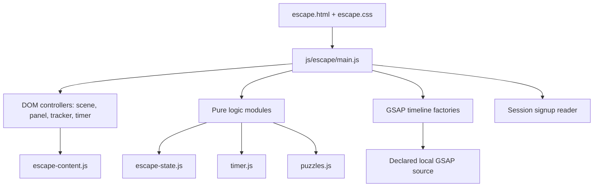
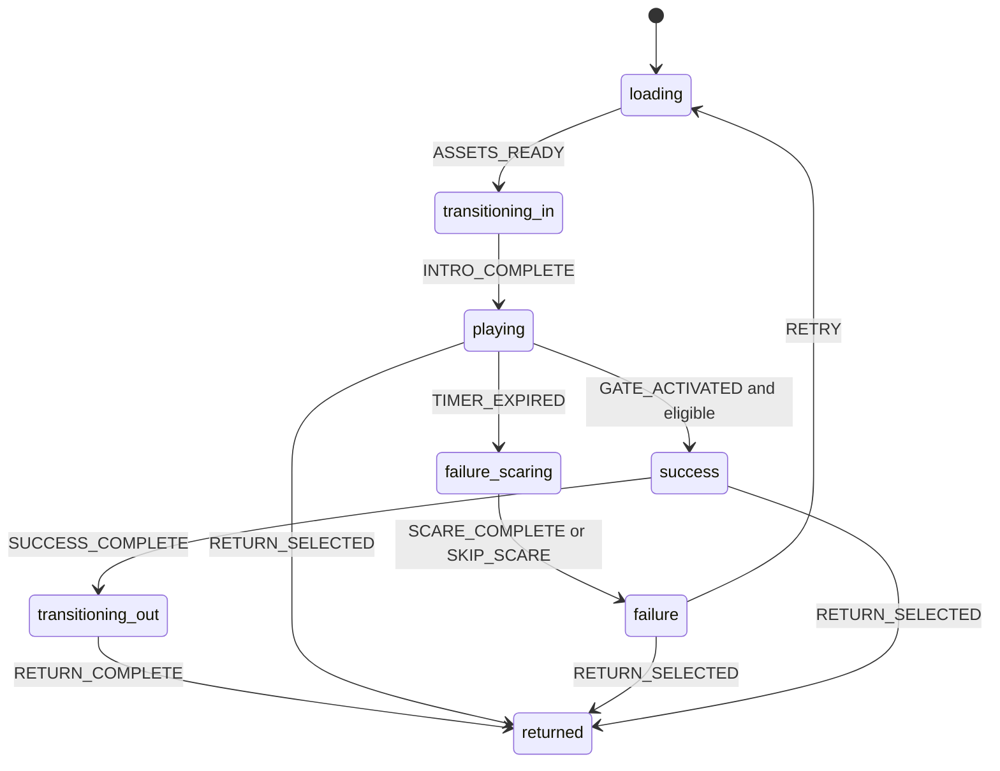

# Design Document

## Overview

Upside_Down_Escape is the second static page in the Nocturne Night experience. The normal landing page handles event information and signup; after its glitch and ominous sequence, it hands off to `escape.html`. The escape page preserves the local session signup record, then presents a seven-minute supernatural puzzle hunt in the Trench of Horror: a sunken ravine around a deserted relay station. A nameless Demon communicates three demands through four clues. The visitor must discover all clues, fulfill all demands, and activate the gate before the timer reaches zero.

The design borrows broad atmospheric cues from 1980s supernatural adventure horror: ordinary equipment behaving strangely, an alternate landscape, a cold palette, haze, and suspense. All scene art, copy, puzzle content, and scare imagery are original. No external game runtime, framework, or server is used.

### Design Decisions

- **Static stack:** HTML, CSS, plain JavaScript ES modules, browser APIs, and the project’s single declared GSAP source.
- **Pure game rules:** Escape reducer, timer, clue tracking, demand validation, and gate eligibility are independent of the DOM.
- **One scene, one page:** `src/escape.html` owns the room. State changes replace scene panels and overlays without a framework router.
- **Seven minutes:** The timer starts at exactly 420 seconds when `playing` begins. It uses an elapsed-time source rather than relying only on the number of interval callbacks.
- **Fair demands:** Each demand becomes available when its supporting clue is found. The clue tells the visitor the exact operation and answer; the Demon’s voice adds tone without withholding necessary information.
- **Scare with a safe fallback:** The jumpscare is an abstract silhouette snap-in with a short transform and opacity timeline. It avoids strobing, does not autoplay sound, and becomes a static result under reduced motion.
- **Local-only data:** Signup details pass through the sessionStorage key documented by the haunted-page spec. Puzzle state lives only in memory.

## Architecture

### Layers



### Project Layout

```text
src/
  escape.html
  escape.css
  js/
    escape/
      main.js
      content.js
      config.js
      storage.js
      logic/
        state.js
        timer.js
        puzzles.js
      ui/
        scene.js
        panel.js
        tracker.js
        controls.js
      anim/
        timelines.js
```

`main.js` wires page events and effects. `logic/` contains pure functions and has no browser or GSAP dependency. `ui/` owns DOM updates and input handling. `anim/timelines.js` is the only module that constructs GSAP timelines. Content, puzzle answers, timing, and destination locations are constants rather than embedded in event handlers.

## Components and Interfaces

| Component | Responsibility | Public interface |
|---|---|---|
| `main.js` | Initialize the page, connect state, timer, UI, and animation events | `initializeEscape()` |
| `logic/state.js` | Apply legal escape-state transitions | `initialEscapeState`, `reduceEscapeState(state, event)` |
| `logic/timer.js` | Derive remaining time from monotonic elapsed time | `createTimer(startedAt)`, `readTimer(timer, now)`, `formatTime(seconds)` |
| `logic/puzzles.js` | Track unique clues and validate the three demands | `discoverClue(progress, clueId)`, `submitDemand(progress, demandId, answer)`, `isGateUnlocked(progress)` |
| `ui/scene.js` | Render the scene and open or close object panels | `bindScene({ onClue, onDemand, onReturn })` |
| `ui/tracker.js` | Render clue and demand totals and accessible announcements | `renderProgress(progress)`, `announce(message)` |
| `ui/controls.js` | Bind puzzle inputs and report submitted answers | `bindPuzzleControls(handlers)` |
| `anim/timelines.js` | Create GSAP transitions and provide reduced-motion/no-GSAP fallbacks | `createEscapeTimelines(gsap, options)` |
| `storage.js` | Read the optional signup record without exposing storage failures | `readSignup(storage)` |

Modules communicate through plain objects and callbacks. Pure logic modules do not import DOM APIs, GSAP, or storage. `main.js` is the composition root and is responsible for checking state and time before dispatching terminal events. UI modules receive callbacks instead of importing game state directly.

The puzzle module accepts only known clue and demand identifiers. It returns updated immutable progress values so callers cannot mutate the prior state accidentally. The animation module accepts DOM targets from the composition root and exposes methods for entry, panel reveal, demand feedback, timeout scare, success, and return transitions.

## Data Models

The following shapes define the data exchanged between modules. Implementations may use JavaScript objects and `Set` internally, but serialized and callback-facing values use plain data.

```ts
type EscapePhase =
  | 'loading'
  | 'transitioning_in'
  | 'playing'
  | 'failure_scaring'
  | 'failure'
  | 'success'
  | 'transitioning_out'
  | 'returned';

type EscapeState = {
  phase: EscapePhase;
  attempt: number;
};

type PuzzleProgress = {
  discoveredClues: string[];
  completedDemands: string[];
};

type TimerState = {
  startedAt: number | null;
  remainingSeconds: number;
  isRunning: boolean;
  isExpired: boolean;
};

type SignupRecord = {
  name: string;
  email: string;
};
```

The four stable clue IDs are `radio-log`, `breaker-note`, `cassette-sleeve`, and `wall-marks`. The three demand IDs are `radio-frequency`, `breaker-sequence`, and `gate-word`. A puzzle progress value starts with two empty arrays. Discovering a clue or completing a demand returns a new value with the identifier appended at most once. Gate eligibility is derived from exactly four unique clues and three unique demands; it is not stored as a separate mutable flag.

Signup data is optional and read from `nocturne-night:signup` in sessionStorage. Invalid, missing, or inaccessible data becomes `null` and the page uses a generic greeting. Signup records and in-progress puzzle state are not persisted by the escape page.

The timer begins with 420 seconds and a null start timestamp. Entering `playing` records a monotonic timestamp. Each read derives remaining seconds from that timestamp; expiry is terminal for the attempt. Retry creates a new attempt with empty puzzle progress and a new timer.

### Escape State Machine



The reducer ignores events that do not match the current state. The timer emits `TIMER_EXPIRED` once. At the zero boundary, the controller processes timer expiration before any gate click in the same frame; a gate activation is eligible only when remaining time is greater than zero and all puzzle conditions are complete.

### Game Data

```js
const GAME_CONFIG = {
  initialSeconds: 420,
  clueCount: 4,
  demandCount: 3,
  signupStorageKey: 'nocturne-night:signup',
  ambientMaximum: 12,
  mobileAmbientMaximum: 6,
  returnDestination: './index.html#signup'
};
```

The constants in implementation may use module exports and must remain the single source of truth for timer limits and destinations.

| Clue ID | Location | Clue shown | Enables demand |
|---|---|---|---|
| `radio-log` | Shortwave radio | “The voice repeats 88.3. Find me between stations.” | Tune radio to 88.3 MHz |
| `breaker-note` | Notice board | “Two before one. One before three. Let the numbered lights return.” | Activate breakers 2, 1, then 3 |
| `cassette-sleeve` | Cassette player | “The word is RETURN. Say it at the gate.” | Enter RETURN on the gate keypad |
| `wall-marks` | Wall markings | Reveals a plain-language reminder that all four traces must be found before the gate will answer; adds lore without another answer puzzle. | Gate eligibility and clue completion context |

There are three demands and four clues. `wall-marks` is required for the clue total but does not add another answer puzzle. The gate becomes eligible only when all clues and all demands are complete.

Puzzle input behavior:

- **Radio:** A labeled numeric input or stepper accepts one decimal value. Submit enables the demand only after its clue has been discovered. Correct value is `88.3`.
- **Breakers:** Three labeled buttons activate a sequence. The sequence resets on an incorrect next breaker and announces the hint to review the notice-board clue. Correct sequence is `2, 1, 3`.
- **Gate keypad:** A labeled text input accepts the case-insensitive word `RETURN`. The demand can only complete after its clue is discovered.
- **Gate:** A native button always exposes its current status. Before eligibility, activation explains the remaining clues or demands without allowing escape; once eligible, it enters success.

### Timer Model

Pure timer state:

```ts
{
  remainingSeconds: 420,
  elapsedMilliseconds: 0,
  isRunning: false,
  isExpired: false
}
```

`start` records a monotonic start point. Each update computes elapsed whole seconds and derives `remainingSeconds = max(0, 420 - floor(elapsed / 1000))`. This avoids accumulating interval drift. The controller updates the visible text at most once per second and announces only at 60 seconds, 10 seconds, zero, and terminal state transitions. Retry creates a new timer state at 420.

### Scene and Visual Direction

- **Palette:** near-black, charcoal blue, cold slate, and pale fog for the base. Signal orange and pale ice are limited accents. Error/failure text uses readable warm ivory rather than large red areas.
- **Typography:** narrow, high-legibility sans serif for controls and timer; restrained display face for short scene headings. Body and puzzle text remain clear and at least 16 px.
- **Composition:** full-height control header for timer and progress, an illustrated trench and relay-station field, object buttons positioned as labeled hotspots, and a persistent readable message panel. On small screens, the scene becomes a vertical stack of large object controls.
- **Atmosphere:** fog sheets and drifting spores sit behind controls, with subtle parallax. Vignette and grain are static overlays. Effects never reduce foreground contrast.
- **The Demon:** messages arrive as brief text in the scene panel, with a restrained border or opacity change. Do not represent it with a copied character silhouette or recognizable franchise creature.
- **Failure:** a dark pause, abstract silhouette growing into view, then a stable failure panel. The scare is brief and skippable; the “You failed” heading and both actions are readable immediately after it.
- **Success:** gate illumination and a reverse dimensional dissolve reveal the normal-page return action.

### Animation System

All animation factories live in `js/escape/anim/timelines.js` and accept `prefersReducedMotion`.

| Timeline | Normal limit | Reduced motion |
|---|---:|---:|
| Forward Handoff | 2000 ms | 300 ms |
| Object/panel reveal | 600 ms | 250 ms |
| Ambient loops | repeating, paused when hidden | disabled |
| Demand feedback | 500 ms | 250 ms |
| Jumpscare | 1800 ms | static result, at most 300 ms |
| Success reveal | 1200 ms | 300 ms |
| Reverse Handoff | 1800 ms | 300 ms |

Use transform and opacity for movement. Filter may be used for a brief static-to-desaturated transition. No fast flashes, full-screen red frames, camera shake loops, or continuously animated text. A skip action cancels the active timeline and dispatches the matching completion event exactly once.

### Accessibility

- Native buttons, inputs, labels, headings, and landmarks provide keyboard and screen-reader semantics.
- Each scene object has a visible label and at least a 44 px target. Hotspot coordinates are decorative placement only; a parallel object list provides reliable access on touch and keyboard layouts.
- The Clue_Tracker is a readable “Clues 0 of 4; demands 0 of 3” status. Updates announce each discovery or completion, not every visual animation frame.
- The timer is visible continuously but not an assertive live region. Announce only threshold and terminal changes.
- A skip-scare control is present before the jumpscare begins; a persistent return action is available in active and terminal states.
- Reduced-motion mode removes continuous fog motion, parallax, shake, and the jumpscare animation while retaining a brief static transition and all puzzle feedback.
- Focus moves into an opened object panel and returns to the activating object when dismissed. Focus moves to the failure/success heading when a terminal panel appears.
- All text and controls maintain at least 4.5:1 contrast. No state is conveyed by color alone.

## Error Handling

| Situation | Handling |
|---|---|
| GSAP unavailable | Add a no-animation class; keep the scene, timer, puzzles, retry, and return usable with immediate state changes. |
| Session storage unavailable or signup absent | Use a generic greeting; continue the game. |
| Invalid puzzle answer | Keep progress, announce the unmet demand, and allow another attempt. |
| Duplicate clue click | Keep clue count unchanged and reopen the known clue content. |
| Duplicate or illegal state event | Reducer returns the current state; terminal sequences cannot repeat. |
| Browser reload during play | Start a fresh attempt at 420 seconds with no puzzle progress. |
| Return destination fails | Keep a stable success/failure panel and expose an ordinary anchor to the configured destination. |
| Timer callback delayed by a background tab | Recompute from monotonic elapsed time on visibility return; expire immediately if the deadline passed. |

## Correctness Properties

**Property 1: Timer is bounded and monotonic.** For every sequence of elapsed-time updates and terminal events, remaining seconds stay within 0–420, equal the configured duration less elapsed whole seconds, and never increase during an attempt. Validates Requirements 6.1, 6.5, 6.7, and 14.1.

**Property 2: State transitions are legal.** For every state/event pair, the reducer returns the documented next state for legal events and the same state for illegal events. Validates Requirements 3.7 and 14.2.

**Property 3: Clues count once.** For any generated sequence of clue activations, discovered count equals the number of unique required clue IDs and remains in 0–4. Validates Requirements 5.2 and 14.3.

**Property 4: Demands require exact answers and clues.** For any ordering of clue discovery and answer submissions, each demand completes only if its clue is discovered and its answer is exact; repeated correct submissions do not increase count. Validates Requirements 5.3–5.5 and 14.4.

**Property 5: Gate eligibility is exact.** Gate is unlocked if and only if all four clues and all three demands are complete. Validates Requirements 5.6–5.7 and 14.4.

**Property 6: Timeout and success are mutually exclusive.** For all permutations of timer-expired and gate-activated events at zero, at most one terminal route is entered and the state cannot be `success` at zero seconds. Validates Requirements 6.5 and 14.5.

## Testing Strategy

- Use the project’s JavaScript test runner and `fast-check` for pure logic properties, with at least 100 runs per property.
- Use in-memory timer clocks and storage stubs; pure tests must not require a browser DOM or GSAP.
- Add unit cases for all puzzle answers, wrong answers, duplicate clue activations, exact 420-to-zero behavior, background-tab catch-up, retry reset, and timeout/gate race handling.
- Browser checks cover keyboard-only play, touch target sizing, 320 px layout, contrast, skip behavior, reduced motion, focus restoration, and timeline fallback when GSAP is unavailable.
- Performance checks cover asset loading, maximum ambient counts, and scene responsiveness with all effects active.

### Requirements Traceability

| Requirement | Main modules |
|---|---|
| 1 Technology | `escape.html`, `escape.css`, `js/escape/*`, README |
| 2 Theme and opening | `content.js`, `escape.css`, `scene.js` |
| 3 State and handoff | `state.js`, `main.js`, `timelines.js`, `config.js` |
| 4 Scene objects | `escape.html`, `scene.js`, `panel.js` |
| 5 Clues and demands | `puzzles.js`, `content.js`, `tracker.js`, `controls.js` |
| 6 Timer | `timer.js`, `main.js`, `tracker.js` |
| 7 Failure and jumpscare | `timelines.js`, `main.js`, `escape.css` |
| 8 Success | `state.js`, `timelines.js`, `main.js` |
| 9 Responsive | `escape.css`, `controls.js` |
| 10 Accessibility | `escape.html`, `escape.css`, `panel.js`, `tracker.js` |
| 11 Performance and resilience | `main.js`, `timelines.js`, `config.js` |
| 12 Privacy | `storage.js`, `main.js` |
| 13–14 Kiro and PBT | spec docs, steering, tests |

