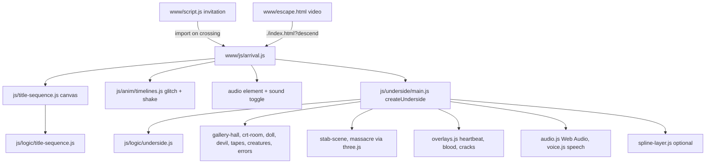
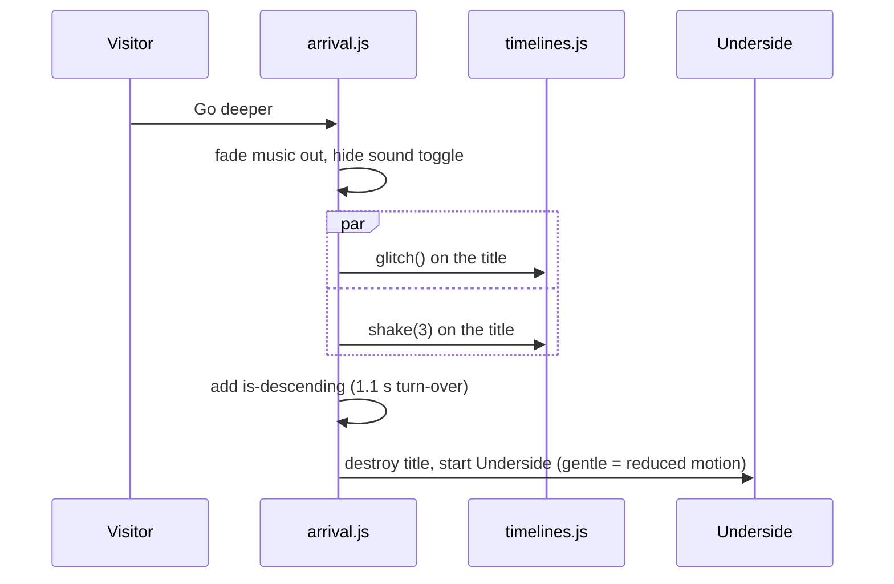

# Design Document

## Overview

Upside_Down_Escape is everything after the invitation's third valid submission. It runs on the same page, `www/index.html`. The invitation (`www/script.js`) finishes its glitch and fade to black, then imports `www/js/arrival.js` and calls `beginTheOtherSide()`. From there:

1. The canvas Title_Sequence plays while the Arrival_Music starts. It resolves the NOCTURNE NIGHT title after 25 seconds and holds it indefinitely, with the message and Go deeper underneath.
2. Go deeper plays the invitation's glitch and strongest shake over the title, turns it over, and starts the Underside.
3. The Underside is a scroll-driven descent through nine Beats and six Locks under a 10-minute Party_Clock. It ends either in an escape to the Outside_Page or, at 3:00 AM, in the time-out finale.

`www/escape.html` is a separate, older entry point. It plays the title video and continues to `./index.html?descend`, which starts the Other_Side directly.

### Design Decisions

- **One page, no navigation.** The other side shares the page with the invitation, so the music, session, and state carry over. `beginTheOtherSide()` hides the invitation (`body.is-other-side`), shows `#other-side`, and clears leftover transforms and filters on `<html>` and `<body>`, because a transform there would trap every fixed full-screen layer.
- **Canvas title on the wall clock.** The Title_Sequence derives every frame from `performance.now() - startTime`. Browsers stop drawing hidden pages, so on return the picture jumps to wherever the music is. A timer, not a frame, fires the settle and skip jumps so they also happen while hidden.
- **Pure rules, thin wiring.** Title timing and camera maths live in `www/js/logic/title-sequence.js`; Underside rules (beats, dread, clocks, gates, scroll limits, flash and scare limits, hold progress) live in `www/js/logic/underside.js`. Both are testable in Node.
- **Shared motion for crossings.** Go deeper reuses `glitch()` and `shake(3)` from `www/js/anim/timelines.js`, aimed at the title element through `glitchTarget` and `shakeTarget`.
- **2D canvas first, 3D where it counts.** Most set-pieces are 2D canvas. three.js r187 (vendored) renders the portrait corridor, the CRT room, the cake stab scene with a scanned head (GLTF), and stylized low-poly gore scenes. Heavy 3D modules are imported on demand.
- **Synthesized sound, recorded voices.** Music and effects are synthesized live with Web Audio and follow Dread. Voice lines are local MP3 files decoded and processed through Web Audio, with speech synthesis as a fallback.
- **Safety in code.** Every flash and jumpscare goes through `createFlashLimiter` and `createScareGate`. Gentle_Mode is a single flag that removes jumpscares, the hammer, gore, and flashes, and adds time.

## Architecture

### Modules



### Project Layout

```text
www/
  index.html            invitation, #other-side (title sequence, Underside, Outside_Page), sound toggle, audio
  escape.html           standalone title video that continues to ./index.html?descend
  style.css             title sequence and sound toggle styles
  underside.css         Underside styles, Go deeper turn-over, Outside_Page
  audio/kiroween-audio.mp3
  videos/title-sequence.webm, title-sequence.mp4
  assets/underside/     found/ (public domain), generated/ (team), models/ (head.glb), voice/ (14 MP3s)
  vendor/three/         three.module.js, three.core.js, addons (GLTFLoader, BufferGeometryUtils, SkeletonUtils)
  js/
    arrival.js          beginTheOtherSide(), title sequence wiring, music and toggle, Go deeper
    title-sequence.js   createTitleSequence(): canvas drawing, clock, skip
    config.js           TITLE_*, SPLINE_*, UNDERSIDE settings
    content.js          underside copy
    logic/
      title-sequence.js schedule, camera, intensity, skip maths
      underside.js      beats, dread, clocks, gates, limits
    anim/timelines.js   shared glitch and shake
    underside/
      main.js           createUnderside(): beats, locks, clock, endings, input
      gallery-hall.js   3D portrait corridor (hall)
      crt-room.js       3D CRT living room (tape)
      tapes.js          Smile Tapes played on the TV
      doll.js           porcelain doll and music box (nursery)
      devil.js          the host (devil)
      creatures.js      2D set-pieces: hammer, arm offer, hands on glass, claw, rain, flood, faces
      stab-scene.js     3D cake stab with the scanned head
      massacre.js       3D low-poly gore scenes
      overlays.js       heartbeat corners, blood, cracks
      errors.js         old-OS error windows
      audio.js          synthesized music and effects, voice clip playback
      voice.js          speech synthesis fallback
      spline-layer.js   optional Spline scenes
tests/underside.test.js
```

## Components and Interfaces

### `js/arrival.js`

| Function | Responsibility |
|---|---|
| `beginTheOtherSide()` | Runs once: clears transforms, hides the invitation, shows the title sequence, starts the title and the music |
| `startTitle()` | Creates the Title_Sequence (`still` under reduced motion), wires Skip intro, shows the Finale on settle |
| `showFinale()` | Unhides the message and Go deeper, fades Skip intro out, moves focus to Go deeper if Skip had it |
| `startSound()` | Plays the Arrival_Music, falls back to muted autoplay plus unmute on first interaction, keeps the toggle state |
| `startDescent()` | Fades the music and hides the toggle; runs glitch + `shake(3)` on the title, then the CSS turn-over, then `createUnderside({ gentle: reducedMotion }).start()` |

`?descend` in the URL calls `beginTheOtherSide()` on load.

### `js/title-sequence.js`

`createTitleSequence({ canvas, bloom, haze, grain, frame }, { onSettle, still })` returns `{ start, skip, destroy }`.

- `start()` starts the clock immediately (together with the music), loads the title font, measures the letters, publishes `--title-bottom` for the Finale's position, and starts drawing. A timer calls `onSettle` when the title resolves.
- `skip()` records the press time; frames fade out over `skipFadeOut`, a timer jumps the clock to `skipLead` before the end, and frames fade back in over `skipFadeIn`.
- Drawing: each letter is layered strokes in one red hue (outer glow, inner glow, tube, highlight) with fake depth of field; a quarter-size copy feeds the CSS bloom; grain is one cached tile moved by CSS.

### `js/logic/title-sequence.js`

`buildSchedule(shots, timing)`, `shotAt`, `masterAlpha`, `isSettled`, `letterMotion`, `drift`, `intensity`, `shotCamera`, `closeUpScale`, `pullCamera`, `skipDip`, `skipTarget`, plus the easing helpers.

### `js/underside/main.js`

`createUnderside({ gentle })` returns `{ start }`. It owns the scroll track, the beats and locks, the Party_Clock, the overlays, the endings, and input (pointer, wheel, touch, keyboard, visibility). `GATE_AT` places each Lock: `host` in hall at 93%, `vcr` in tape at 60%, `music` in nursery at 45%, `doors` in rooms at 90%, `leave` in leave at 40%, `rsvp` in devil at 50%.

### `js/logic/underside.js`

| Export | Rule |
|---|---|
| `BEATS`, `beatAt(progress)` | Nine beats with end positions: hall 0.10, tape 0.20, nursery 0.32, eyes 0.38, rooms 0.52, leave 0.60, hallway 0.78, devil 0.90, exit 1.00 |
| `dreadAt(progress)` | Bounded 0..1, non-decreasing |
| `limitScroll(...)` | Capped view speed; the scroll is pulled back instead of skipping |
| `applyGates(targetY, gates)` | A target position never passes an unsolved gate |
| `createFlashLimiter({ max = 3, windowMs = 1000, gentle })` | At most 3 flashes per second; none in gentle mode |
| `createScareGate({ maxPerRun = 2, minGapMs = 45000, gentle })` | At most 2 jumpscares per run, 45 s apart; none in gentle mode |
| `createBacktrackDetector(threshold)` | Notices scrolling back past a threshold |
| `holdProgress(current, dt, holding, { fillMs = 2600, drainMs = 5200 })` | Escape hold meter within 0..1 |
| `countdown`, `partyClock`, `minutesTowardThree`, `minutesLabel`, `clockLabel`, `timecode` | Clock maths and formats |
| `figureStep`, `tapeAt`, `errorCount`, `roomLabel`, `guestName` | Set-piece pacing and the visitor's display name |

## Data Models

### Title configuration (`js/config.js`)

```js
TITLE_FONT = '"Playfair Display", Georgia, serif';
TITLE_LINES = [{ text: 'NOCTURNE', size: 200, track: 8 }, { text: 'NIGHT', size: 170, track: 18 }];
TITLE_SHOTS = five close-ups with d = 3600, 1800, 1800, 2000, 1800 ms;
TITLE_PULL_FROM = { i: 4, fx: 0.5, fy: 0.4, z: 5 };
TITLE_TIMING = { blackout: 2000, fadeIn: 1600, pull: 12000, skipFadeOut: 900, skipFadeIn: 1500, skipLead: 6000 };
```

The shots start at 2.0, 5.6, 7.4, 9.2, and 11.2 seconds; the pull-back runs from 13 to 25 seconds; the title then holds.

### Underside configuration (`UNDERSIDE` in `js/config.js`)

| Key | Value | Use |
|---|---|---|
| `timeLimitMs` | 600000 | 10-minute Party_Clock (2:50 to 3:00 AM) |
| `gentleExtraMs` | 120000 | Extra time in Gentle_Mode |
| `maxScreensPerSecond` | 1.15 | Scroll speed cap |
| `scareMs` | 850 | Jumpscare length |
| `afterEscapeMs` | 6500 | Delay before the Outside_Page scare |
| `escapedKey` | `nocturne-night:escaped` | Set after an escape |
| `voiceDir` | `./assets/underside/voice/` | Voice clips |
| `scares`, `foundImages`, `broadcastFootage`, `familyImage` | image paths | Set-piece imagery (see `ASSETS.md`) |

`SPLINE_SCENES` has three optional slots (`watcher`, `door`, `figure`); all are empty, so the Spline runtime is not loaded.

### Session data

- `nocturne-night:signup`: `{ name, email }` from the invitation; read for the visitor's name and the RSVP lock.
- `nocturne-night:escaped`: `'1'` after an escape or the time-out ending.

## Flows

### Go deeper



### Underside endings

- **Escape:** hold to escape fills the meter; the house rotates upright (1.6 s), the Outside_Page appears with focus on its heading, the escaped flag is set, and after 6.5 seconds one final Jumpscare shows (not in Gentle_Mode).
- **Time-out:** at zero, "The party has ended." is shown and spoken. Outside Gentle_Mode the full finale plays and ends on a forced Jumpscare. In Gentle_Mode only the text plays, then the visitor returns to the invitation.

## Accessibility and Safety

- The Title_Sequence canvas has `role="img"` and a text label; the Finale message and Go deeper are real text and a native button.
- Skip intro, Go deeper, the sound toggle, the lock controls, and the escape button are native buttons with visible focus; the wind and escape holds also work with the keyboard.
- Reduced motion: the title shows its final frame, Go deeper fades instead of glitching, and the Underside runs in Gentle_Mode.
- Flash and scare limits apply to every effect; blood stays dark red; text sits above all overlays.
- Live regions announce the Underside's key moments, such as the party ending.

## Error Handling

| Situation | Handling |
|---|---|
| Audible autoplay blocked | Play muted; unmute on the first interaction outside the toggle |
| Audio file or Web Audio fails | Continue silently |
| Voice clip fails | Speak the line with speech synthesis |
| GSAP unavailable | CSS glitch and shake, then continue; the Underside's upright turn waits instead of animating |
| Title font fails to load | Draw with the Georgia fallback |
| Page hidden during the title | The clock keeps running; the settle and skip timers still fire |
| Signup record missing | Use a generic name |
| Spline scene URL empty | Use the built-in canvas creature |

## Testing Strategy

- `npm test` runs `tests/underside.test.js` with Node's built-in test runner: 19 tests of the Underside rules (dread, beat order, flash limit, gentle mode, scare cap and spacing, figure steps, backtracking, hold range, guest names, clock formats, card length, tape order, clock arrival, error windows, scroll cap, countdown, gates).
- `tests/landing.test.js` covers the Title_Sequence schedule: cut times, the 25 s settle, the fade-in that never fades out, and the Skip intro dip and target.
- `?time=SECONDS` and `?debug` (`window.__underside`) support manual and automated browser walkthroughs.
- Browser checks: the title in a hidden tab, Skip intro timing, reduced motion, keyboard-only play, and the escape and time-out endings.

## Requirements Traceability

| Requirement | Main modules |
|---|---|
| 1 Technology | `index.html`, `vendor/three/`, `spline-layer.js`, `js/logic/` |
| 2 Title sequence | `title-sequence.js`, `logic/title-sequence.js`, `arrival.js`, `style.css` |
| 3 Music and toggle | `arrival.js`, `index.html`, `style.css` |
| 4 Go deeper | `arrival.js`, `anim/timelines.js`, `underside.css` |
| 5 Title video page | `escape.html`, `arrival.js` |
| 6 Structure and movement | `underside/main.js`, `logic/underside.js` |
| 7 Locks | `underside/main.js`, `gallery-hall.js`, `crt-room.js`, `doll.js`, `devil.js`, `creatures.js` |
| 8 Party clock and time-out | `underside/main.js`, `logic/underside.js`, `config.js` |
| 9 Escape and Outside_Page | `underside/main.js`, `index.html`, `underside.css` |
| 10 Safety | `logic/underside.js`, `underside/main.js` |
| 11 Overlays and sound | `overlays.js`, `audio.js`, `voice.js` |
| 12 Content and assets | `content.js`, `assets/underside/`, `ASSETS.md` |
| 13 Performance | `underside/main.js`, `overlays.js`, `title-sequence.js` |
| 14 Privacy | `storage.js`, `underside/main.js` |
| 15 Testing | `tests/underside.test.js` |
| 16 Kiro | spec documents, steering |
